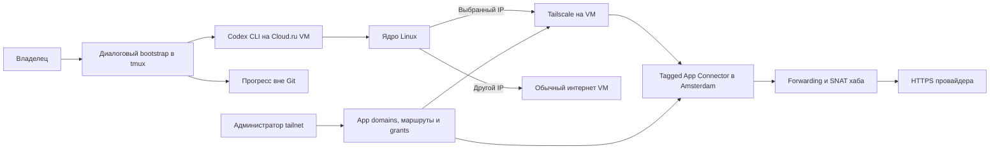

# HLD и LLD пилота

## Порядок чтения

Этот файл — краткий обзор и путеводитель. Подробные схемы разделены по уровню и сценарию:

1. [HLD](HLD.md): участники, границы доверия, отдельный Connector и разделение control/data plane.
2. [LLD](LLD.md): интерфейсы, namespace, DNS discovery, одобрение `/32`, таблицы маршрутизации и обратный NAT.
3. [Packet walk](PACKET-FLOW.md): путь пакетов при авторизации, запросе к модели, прямом трафике, DERP, смене DNS и отказе.
4. [Безопасность](SECURITY.md): возможности второго root, минимальные разрешения, сетевое отключение и отзыв авторизации Codex.
5. [Приёмка](ACCEPTANCE.md): какие наблюдения подтверждают каждый уровень результата и чего они не доказывают.
6. [Временный сервисный допуск](TEMPORARY-ACCESS.md): настройка с хаба без передачи OAuth либо временный локальный Codex, отзыв доступов и очистка по инвентарю.

На схемах используются условные адреса, а не параметры рабочего tailnet. Mermaid-блоки доступны прямо на GitHub. Изолированный контейнер Connector отделяет его состояние и сетевые настройки от основного `tailscaled` хаба; запрет доступа клиентской VM к остальной инфраструктуре задаётся отдельно политикой tailnet.

## Назначение и границы

Нативный Codex на Cloud.ru VM открывает обычный HTTPS. При установленном App Connector маршруте ядро VM направляет пакеты к выбранным IP через Tailscale на Amsterdam-хаб. Хаб выполняет обычный forwarding/SNAT; TLS остаётся между CLI и провайдером. Proxy в Codex, API-прослойка и копирование OAuth с хаба для такого маршрута не нужны.

Пилот не отменяет требования провайдеров к учётной записи, региону использования и подписке. Разрешение использования проверяет владелец.

## Компоненты и файлы

| Компонент | Реализация | Сохраняемое состояние |
|---|---|---|
| Вход | `bin/bootstrap` | Отдельный tmux socket и сессия |
| Диалог | `src/tailnet_bootstrap/cli.py` | Этапы, несекретный профиль, отчёт |
| Установка | `installers.py`, `installer-lock.json` | Подписанный apt-репозиторий, полный пакет Codex |
| Сеть | `network.py` | Проверки DNS/маршрута/egress, baseline RouteAll |
| Прогресс | `state.py` | JSON, flock, атомарная запись, durable checkpoint |
| Центральная часть | `docs/HUB-SETUP.md` | Проверенная существующая политика tailnet |

Рабочие файлы по умолчанию: `/var/lib/tailscale-codex-bootstrap/{profile.json,state.json,network-report.json}`. Каталог 0700, файлы 0600. Авторизационные коды и OAuth-файлы в них не сохраняются. Установщик не читает `auth.json`; авторизацию выполняет штатный Codex от имени root данной VM.

Поддерживаемая матрица кода: Ubuntu 22.04/24.04, Debian 12/13, amd64/arm64, systemd. Это матрица проверок установщика; сквозной прогон на Cloud.ru VM является отдельной приёмкой. Иные ОС завершаются явной ошибкой до установки.

## Порядок настройки

1. Проверка ОС и архитектуры; установка отсутствующих Python/tmux для сохранения сессии.
2. Настройка локального профиля с проверенным публичным IPv4 хаба.
3. Установка отсутствующих зависимостей и Tailscale из подписанного официального репозитория; установка Codex 0.172.0 через закреплённый по SHA-256 официальный installer полного пакета. Работающая существующая CLI сохраняется и помечается отдельно от проверенного полного пакета.
4. Интерактивное подключение новой VM к существующему tailnet. Существующая чужая/остановленная регистрация не сбрасывается.
5. Проверка всей области предлагаемых маршрутов. После подтверждения сохраняется исходное значение и включается только `--accept-routes=true`. Если нет нужного тега connector, не используется DNS Tailscale, найден exit node/proxy или посторонние маршруты — остановка до изменения.
6. Read-only приёмка DNS → все текущие IP → kernel route → выбранный connector → контрольный внешний IP.
7. Отдельно штатный `codex login --device-auth`, запуск CLI и ручная проверка реального запроса/streaming.

## Надёжность и точные ограничения

Повторный запуск сверяет состояние ОС/служб и сохраняет существующие настройки. Один процесс настройки защищён отдельным flock; сетевой baseline и намерение изменения сохраняются до RPC к tailscaled. При аварии после применения intent остаётся для отката. Откат проверяет идентичность ноды и исходный профиль; не удаляет Tailscale, Codex или учётную запись.

SSH-disconnect не прерывает процесс в tmux. После перезагрузки процесс tmux утрачен: нужно повторить bootstrap; сохранённый прогресс остаётся. Установщик не перезагружает VM и не обещает восстановить память работающего Codex после reboot.

Это выбор маршрута по IP назначения для всех процессов. Общий CDN-IP может направить через хаб и другой домен. При исчезновении маршрута или новом ещё не одобренном IP возможен прямой выход VM. V1 не является постоянным fail-closed контролем и не обещает «только трафик процесса Codex». `NETWORK_VERIFIED` относится к текущему DNS/IPv4-снимку; доступный IPv6 блокирует его до отдельной приёмки. Изменения DNS/CLI/политики требуют повторной проверки.

## Полнота результата

| Статус | Доказательство | Чего не доказывает |
|---|---|---|
| Компоненты установлены | Версии, активность tailscaled, пакет | Маршрут и вход в модель |
| `NETWORK_VERIFIED` | Проверенные IP/PrimaryRoutes/kernel routes/HTTPS echo/non-AI | Постоянную защиту от прямого обхода; IP в логах OpenAI |
| `CODEX_VERIFIED` в ручном отчёте | Реальный вход, ответ, streaming, инвентарь адресов | Будущую доступность подписки и неизменность DNS |

Автоматического присвоения `CODEX_VERIFIED` по коду возврата CLI нет.

Исходный архитектурный документ:

https://github.com/djd1m/corp-infra-architecture/blob/docs/tailscale-app-connector-egress/features/landscape-expansion-20261015/04_architecture/03b-tailscale-app-connector-HLD-LLD-packet-flow.md
