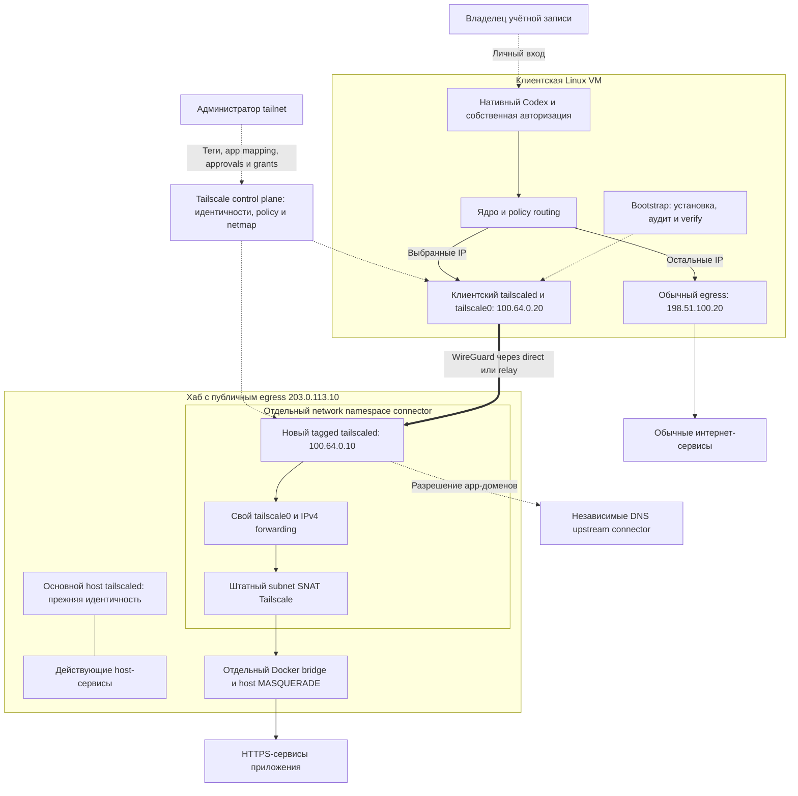
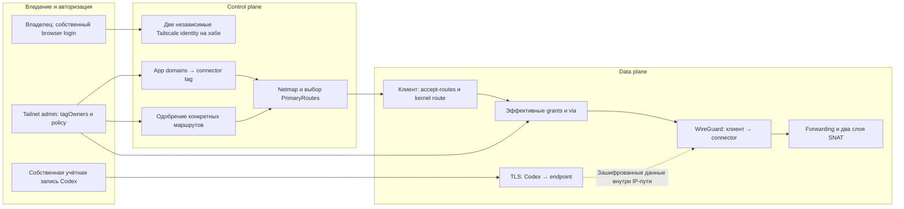
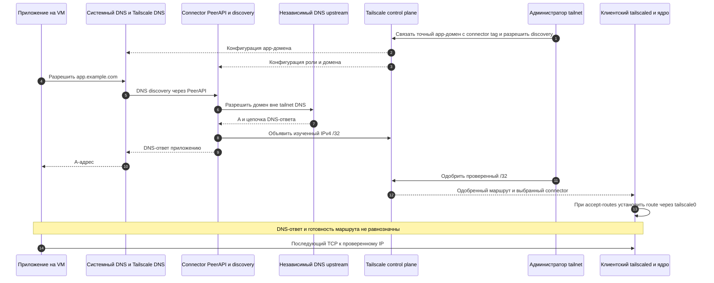
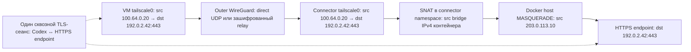

# HLD: нативный Codex через изолированный Tailscale App Connector

## Назначение и статус документа

Документ описывает архитектуру пилота: нативный Codex на клиентской Linux VM обращается к выбранным HTTPS-сервисам через отдельную tagged-ноду App Connector на существующем хабе. Приложение использует обычные сокеты, системный resolver и собственный TLS. Выбор пути выполняется ниже приложения, по IP назначения. Доменная конфигурация помогает **изучить IP-маршруты**, но не превращает маршрутизатор в HTTP-прокси или фильтр имён сайтов.

Основание описания — [клиентский код](../src/tailnet_bootstrap/network.py), [координатор CLI](../src/tailnet_bootstrap/cli.py), [Compose-шаблон](../hub/compose.yaml) и [порядок ручного развёртывания](ISOLATED-CONNECTOR.md). Они задают проектируемое поведение. Наличие документации и успешная статическая проверка не подтверждают развёртывание контейнера, действующую policy, реальные NAT-правила или запрос Codex к модели. Это подтверждается отдельной [приёмкой](ACCEPTANCE.md).

Во всех схемах `100.64.0.20` — условный Tailscale IPv4 клиента, `100.64.0.10` — **новой connector-ноды**, `203.0.113.10` — условный публичный IPv4 хаба, `198.51.100.20` — условный обычный публичный egress клиента. `tail000000.ts.net`, `app.example.com`, `192.0.2.42` и частная bridge-сеть — документационные примеры. Они не описывают инфраструктуру автора и не являются рабочим профилем. Адреса TEST-NET намеренно не проходят проверку публичного egress в `validate_profile()`. Реальные адреса, node ID, DNS suffix и результаты обследования хранятся вне Git.

Детали реализации находятся в [LLD](LLD.md), последовательности пакетов — в [PACKET-FLOW](PACKET-FLOW.md), границы доверия и секретов — в [SECURITY](SECURITY.md).

## Контекст и две независимые идентичности на хабе

На хабе сохраняется основной host `tailscaled` с прежними состоянием, пользовательской идентичностью и доступами к действующим приложениям. В Docker работает **второй** `tailscaled`: собственная регистрация, tag, Tailscale IP, ключи, socket и network namespace. Клиентский `hub_ip` указывает на connector, а не на основной host daemon.

Сплошные линии показывают data plane. Пунктир показывает настройку, discovery или управление. Основной host `tailscaled` не является промежуточной overlay-нодой на пути клиент → connector. При этом host kernel и Docker всё равно участвуют в передаче наружу: отдельный namespace не означает отдельное ядро или независимый firewall.

| Узел / роль | Ответственность | Существенная граница |
|---|---|---|
| Владелец клиентской VM | Запускает bootstrap и собственный Codex | Bootstrap работает от root согласно текущему CLI |
| Нативный Codex | Вход, HTTPS-запросы, inference и streaming | Учётная запись приложения отдельна от Tailscale |
| Клиентский Linux и `tailscaled` | Системный DNS, маршруты и шифрованный overlay | Принятые маршруты влияют на все процессы VM |
| Connector `tailscaled` | Discovery app-доменов, advertisement и forwarding | Отдельная tagged identity и собственный секретный state |
| Docker и host kernel | Bridge, veth, исходящий NAT и conntrack | Общий kernel и host networking остаются зоной администратора хаба |
| Основной host `tailscaled` | Прежний доступ к хабу и его сервисам | Не передаёт свои socket, state или identity контейнеру |
| Администратор tailnet | Эффективная policy, теги, approvals, grants и `via` | Клиентский bootstrap этих полномочий не получает |
| Tailscale control plane | Распространяет конфигурацию и выбранные маршруты | Не является HTTPS endpoint приложения |
| DNS upstream | Возвращает DNS-ответы connector | Его путь не должен возвращать app-запросы в тот же connector |
| HTTPS endpoint | Завершает TLS и наблюдает внешний IP соединения | Видит собственный запрос, а не результаты контрольного echo |

## Control plane, data plane и владение

В этой архитектуре необходимо различать три независимых решения. **Control plane** сообщает нодам, какие app-домены связаны с каким tag и какие маршруты одобрены. **Data plane** направляет и фильтрует IP-пакеты, выполняет инкапсуляцию и NAT. **Владение и авторизация** определяют, кто вправе зарегистрировать устройство, назначить tag, изменить policy или войти в Codex.

Объявление маршрута, его одобрение, принятие клиентом и разрешение пакетов — разные условия. Наличие grant само по себе не устанавливает маршрут. Наличие маршрута не доказывает разрешение трафика или доступность connector. Это разграничение задано [документацией route injection](https://tailscale.com/docs/reference/route-injection).

Для connector требуется tag. Использование отдельной ноды позволяет сохранить пользовательскую идентичность основного хаба. Login connector выполняет владелец в своём браузере, затем отдельно включается `--advertise-connector=true`. В Compose нет auth key или автоматического входа. Отдельный собственный `codex login --device-auth` выполняется на клиентской VM. Копирование OAuth с хаба в проект не входит.

## Физиология: DNS сначала создаёт предпосылки маршрута

Доменная конфигурация не передаёт готовый HTTP-запрос на хаб. Запрос системного resolver для выбранного домена запускает discovery через Tailscale DNS/PeerAPI. Connector разрешает имя через свои независимые upstream, наблюдает полученные IP и объявляет соответствующие host routes. Для IPv4 это `/32`. До одобрения, распространения маршрута и клиентского `accept-routes` рабочий путь ещё не установлен. Официальное описание механизма: [How app connectors work](https://tailscale.com/docs/features/app-connectors#dns-discovery-mechanism).

Схема показывает зависимости, а не обещанный синхронный барьер перед первым TCP SYN. Пилот сначала инициирует discovery; после проверки и одобрения администратором оператор повторяет проверку готовых маршрутов. В клиентском коде нет цикла ожидания approval. Новому адресу CDN может требоваться новое ручное одобрение. Узкий `autoApprovers.routes` допустим только для отдельно согласованных конкретных префиксов; шаблон не даёт автоматическое одобрение всего IPv4/IPv6 интернета. Настройка роли и минимального discovery access описана в [официальной инструкции](https://tailscale.com/docs/features/app-connectors/how-to/setup).

Независимые DNS upstream являются частью архитектуры, а не косметической настройкой Docker. Если embedded DNS контейнера наследует host resolver с MagicDNS, app-запрос может вернуться в этот же connector. Поэтому Compose требует два явных IPv4 upstream без defaults, а контейнерный Tailscale входит с `--accept-dns=false`. Последний флаг сам по себе не устраняет унаследованный Docker upstream. Администратор проверяет каждый выбранный resolver из network namespace connector. См. [Docker DNS services](https://docs.docker.com/engine/network/#dns-services) и [LLD](LLD.md#dns-discovery-и-защита-от-рекурсии).

## Физиология: HTTPS и два слоя NAT

После готовности маршрута Linux VM направляет пакет к выбранному IP в `tailscale0`. Внутренний исходный адрес — Tailscale IP клиента. Connector снимает outer WireGuard-инкапсуляцию, передаёт внутренний пакет своему kernel и маршрутизирует его наружу через `eth0`. Штатный subnet SNAT Tailscale меняет источник на адрес `eth0` контейнера в bridge-сети. Docker на хосте затем выполняет второй MASQUERADE на адрес исходящего host-интерфейса.

Это ожидаемый **двойной NAT для kernel-mode bridge-варианта со штатным SNAT**. Основание: [default SNAT subnet router](https://tailscale.com/docs/features/subnet-routers#how-subnet-routers-work), upstream [правило Tailscale MASQUERADE](https://github.com/tailscale/tailscale/blob/445df50dcf76b6172dc4688c2097c47878f41641/util/linuxfw/iptables_runner.go#L451-L459) и [Docker bridge masquerading](https://docs.docker.com/engine/network/drivers/bridge/#options). Замена source на bridge IPv4 — вывод из MASQUERADE на выходном `eth0` этого namespace, а не результат packet capture живой системы. Реальные правила в обоих namespace и внешний IPv4 нужно проверить. Если публичный адрес назначен облачным NAT за хостом, существует дополнительная трансляция вне Docker; публичный egress всё равно измеряется отдельно.

Outer path может идти direct между peers или через DERP. Поддерживаемый Tailscale peer relay — ещё один возможный transport path, если настроен в tailnet. Эти варианты сохраняют шифрование между клиентской Tailscale-нодой и connector, но отличаются задержкой и пропускной способностью. DERP не становится endpoint TLS приложения и не задаёт публичный IP соединения connector → приложение. См. [Connection types](https://tailscale.com/docs/reference/connection-types).

На connector заканчивается WireGuard-защита внутреннего IP-пакета, но TLS приложения продолжается до HTTPS endpoint. В архитектуре нет TLS termination, подмены CA, MITM или API-прослойки. Host/connector могут наблюдать сетевые метаданные и DNS; конфиденциальность содержимого зависит от штатной проверки TLS клиентом. Внутренний IP VM не добавляется сетевым SNAT в HTTP-заголовки.

## Изоляция connector и эксплуатационная модель

| Решение шаблона | Назначение | Граница гарантии |
|---|---|---|
| Отдельный user-defined bridge | Свой veth, адрес и маршруты контейнера | Docker создаёт host bridge/firewall/NAT правила |
| `cap_drop: ALL`, затем `NET_ADMIN`, `NET_RAW` | Kernel networking для отдельного daemon | Это всё ещё привилегии над сетевым namespace |
| `/dev/net/tun` и `--tun=tailscale0` | Свой TUN в kernel mode | Доступность TUN и поддержки kernel проверяется на хосте |
| Отдельный bind-mounted state | Сохраняет новую node identity после recreate | State содержит секретные ключи и защищается вне Git |
| Собственный socket в tmpfs | Локальное управление container daemon | Команды выполняются через `docker compose exec connector` |
| Явные DNS и `--accept-dns=false` | Не возвращать app DNS в тот же tailnet | Независимость upstream требует реальной проверки |
| IPv4 forwarding внутри namespace | Пересылка app-пакетов | Не доказывает наличие host FORWARD/SNAT и центральной policy |
| IPv6 bridge выключен, forwarding `0` | Ограничивает контейнерную часть IPv4-пилотом | Не отключает публичный IPv6 клиентской VM |
| Image по SHA-256, ограничения ресурсов и local logging | Воспроизводимость и ограничение потребления | Digest и лимиты проверяются администратором при развёртывании |

В Compose отсутствуют `network_mode: host`, `privileged`, Docker socket, host Tailscale socket/state и published ports. Namespace isolation уменьшает пересечение двух daemon, но общий kernel, Docker Engine и host firewall остаются общей зоной отказа. Перед запуском снимают приватный baseline и после запуска проверяют прежние SSH и host-сервисы; подробный порядок находится в [ISOLATED-CONNECTOR](ISOLATED-CONNECTOR.md).

## Состояния, критерии готовности и пределы доказательства

| Состояние / артефакт | Что установлено | Что ещё требуется |
|---|---|---|
| Компоненты установлены | Пакеты/CLI присутствуют, daemon проверен установщиком | Регистрация, policy и маршрут |
| Connector зарегистрирован | Новая отдельная нода вошла в ожидаемый tailnet | Tag, роль, DNS, approvals, forwarding и grants |
| `HUB_ROLE_PRESENT_POLICY_NOT_VERIFIED` | `hub-check` видит ожидаемый локальный IP, tag и роль | Центральная policy и приёмка с отдельной VM |
| `network.apply.status = pending` | Baseline и намерение сменить RouteAll записаны до внешней операции | Проверить фактическое preference после сбоя или выполнить безопасный rollback |
| `network.apply.status = applied` | Daemon подтвердил включение RouteAll | Read-only `verify` и отдельный Codex |
| `NEEDS_HUB_ADMIN` | Выявлена проблема connector или области маршрутов | Действия администратора tailnet и повторная проверка |
| `NETWORK_NOT_VERIFIED` | Сетевые условия не доказаны | Устранение blockers и свежий `verify` |
| `NETWORK_VERIFIED` | Текущие DNS/IPv4 routes, connector и HTTPS echo согласованы | Реальная авторизация, inference, streaming и полнота доменов приложения |
| `CODEX_VERIFIED` в ручной приёмке | Зафиксирован успешный реальный сценарий Codex | Повторная приёмка после существенных изменений |

`NETWORK_VERIFIED` — снимок, а не непрерывный сетевой контроль. Автоматический `verify` проверяет все текущие IPv4 DNS-ответы профиля, exact `/32` PrimaryRoutes ожидаемой ноды, kernel route через `tailscale0`, отсутствие неподходящего IPv6 и HTTPS echo. Для echo соединение закреплено на **первом** из уже проверенных A-адресов, при сохранении имени TLS. Это не запрос echo ко всем IP и не доступ к журналам OpenAI. Независимый non-AI endpoint дополнительно проверяется, только если задан в профиле.

Пригодный публичный IPv6-путь клиента или предлагаемые IPv6 subnet routes блокируют текущий IPv4-пилот. Наличие Tailscale IPv6-адреса само по себе не означает публичный IPv6 egress. Вход, refresh, inference, streaming, клиентские DNS/DoH и UDP/443 принимаются отдельно. Завершение процесса CLI с кодом `0` не присваивает `CODEX_VERIFIED`.

## Ограничения и решения вне текущего пилота

| Ограничение | Следствие | Что проверять / проектировать отдельно |
|---|---|---|
| Маршрутизация по IP | Любой процесс VM к этому IP использует тот же путь | Изоляцию процесса или workload при отдельном требовании |
| Общие CDN-IP | Через connector может пойти другой hostname на том же IP | Область влияния DNS-ответов и эффективной policy |
| DNS и CDN меняются | Новый IP может отсутствовать среди одобренных маршрутов | Повторное discovery, узкое одобрение и свежую приёмку |
| Нет постоянного fail-closed | При исчезновении маршрута возможен обычный egress VM | Отдельную firewall enforcement-модель и её тесты |
| `accept-routes` действует глобально | Установка preference затрагивает все предлагаемые subnet/app routes | Аудит всего tailnet, а не только доменов профиля |
| ACL/grants складываются | Узкий новый grant не отменяет существующий широкий доступ | Полную эффективную policy |
| Один connector | Доступность зависит от контейнера, хоста, DNS и канала | HA и отдельную проверку egress каждого кандидата |
| Контрольный echo отдельный | Доказан source IP только его соединения | Реальный сценарий провайдера и доступные внешние наблюдения |
| tmux сохраняет процесс после SSH-disconnect | Bootstrap можно продолжить после потери SSH | После reboot требуется новый запуск, память Codex не восстанавливается |

Проект не автоматизирует изменение центральной policy, ручное одобрение новых маршрутов или развёртывание хаба с клиентской VM. Он не делает приложение анонимным и не меняет условия учётной записи или использования сервиса. Риск, секреты и публичные артефакты разобраны в [SECURITY](SECURITY.md), а точные переходы локального состояния — в [LLD](LLD.md#транзакция-apply-и-ограниченный-rollback).
