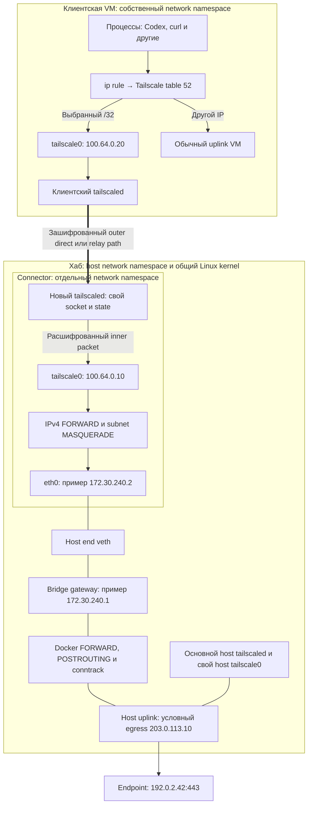
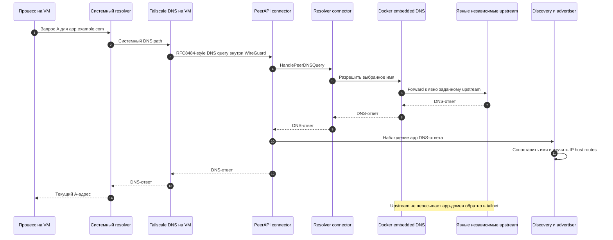
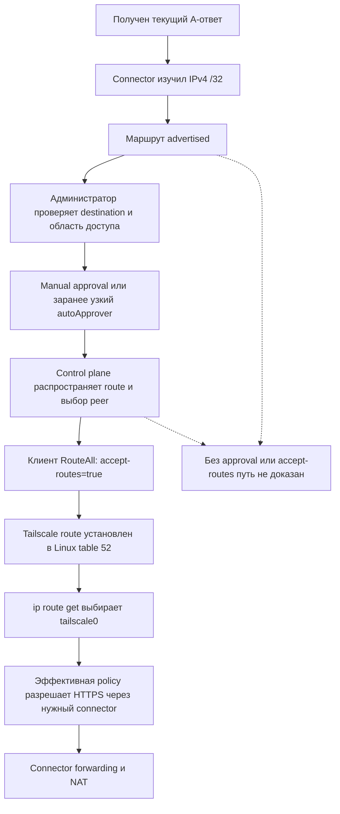
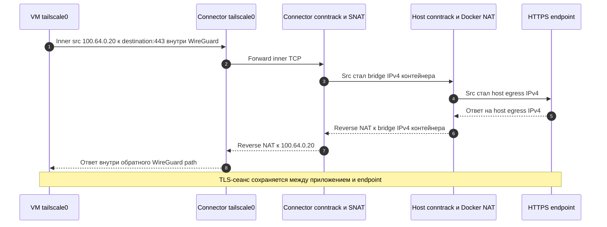
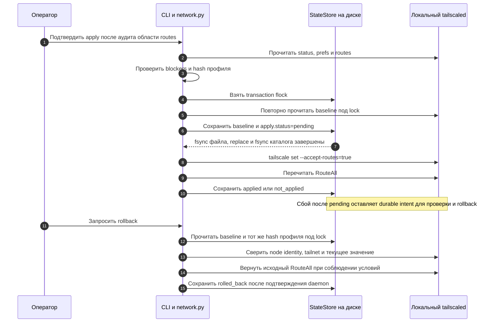

# LLD: namespace, DNS, маршруты и состояние bootstrap

## Область и источники реализации

Этот документ детализирует [HLD](HLD.md) на уровне интерфейсов, конфигурации и проверок. Он описывает текущие [network.py](../src/tailnet_bootstrap/network.py), [cli.py](../src/tailnet_bootstrap/cli.py), [runner.py](../src/tailnet_bootstrap/runner.py), [state.py](../src/tailnet_bootstrap/state.py) и [hub/compose.yaml](../hub/compose.yaml). Развёртывание connector выполняется вручную по [ISOLATED-CONNECTOR](ISOLATED-CONNECTOR.md); bootstrap клиентской VM его не создаёт.

Все адреса и имена ниже условны: клиент Tailscale `100.64.0.20`, connector Tailscale `100.64.0.10`, hub public egress `203.0.113.10`, обычный client egress `198.51.100.20`, endpoint `192.0.2.42`, DNS suffix `tail000000.ts.net`, домен `app.example.com`. Частная сеть `172.30.240.0/28` также пример, а не рекомендованный свободный диапазон. Реальные значения устанавливают после обследования, держат вне Git и не включают в публичную документацию. TEST-NET адреса здесь объясняют заголовки пакета, но не подходят для запуска `validate_profile()`.

## Анатомия namespace и интерфейсов

Outer transport в схеме свёрнут в одно ребро: он также проходит через обычные интерфейсы, veth/bridge и host NAT на стороне контейнера. Нельзя искать расшифрованный client → provider поток на `tailscale0` основного host daemon: connector расшифровывает его в **своём** namespace. Host uplink несёт outer overlay-пакеты и отдельный исходящий HTTPS-трафик после forwarding.

| Объект | Где существует | Назначение / инвариант |
|---|---|---|
| Клиентский `tailscale0` | VM | Kernel route выбранных IPv4 должен выбирать этот интерфейс |
| Клиентская table `52` и `ip rule` | VM, обычный Linux policy-routing режим Tailscale | Tailscale routes отделены от main table; итоговый `route get` важнее одного листинга |
| Основной host `tailscale0` | Хаб, host namespace | Прежняя host identity, не интерфейс connector |
| Connector `tailscale0` | Namespace контейнера | Явно создаётся `tailscaled --tun=tailscale0` |
| Connector `eth0` | Namespace контейнера | Docker bridge IPv4, gateway и выход во внешний мир |
| veth / bridge | Хаб, host namespace | Соединяют network namespace контейнера с Docker сетью |
| TUN device | Host device передан контейнеру | `/dev/net/tun` позволяет создать свой kernel TUN, не передаёт host TUN identity |
| Connector Unix socket | Container tmpfs `/run/tailscale` | `/run/tailscale/tailscaled.sock`, доступ через `docker compose exec connector` |
| Connector persistent state | Bind mount → container `/var/lib/tailscale` | Только новая identity, не host `/var/lib/tailscale` |

Номер table `52` — механизм Linux-реализации, а не обещание универсальности для всех ОС/режимов Tailscale. В проверенном upstream source он задан в [router_linux.go](https://github.com/tailscale/tailscale/blob/445df50dcf76b6172dc4688c2097c47878f41641/wgengine/router/osrouter/router_linux.go#L1561-L1582). Ссылки на commit Tailscale в этом документе фиксируют проверенный исходный механизм, а не доказывают совпадение с выбранным deployment image digest. Bootstrap не создаёт таблицу вручную и не проверяет её номер: `verify()` использует `ip -j route get <address>` и требует `dev = tailscale0` для каждого текущего A-адреса.

## Контракт Compose

| Поле шаблона | Текущее значение / требование | Что обеспечивает |
|---|---|---|
| `image` | Обязательный `TAILSCALE_IMAGE` | Администратор проверяет официальный immutable digest `tailscale/tailscale@sha256:…` |
| `entrypoint` | `/bin/sh -ec`, затем `exec tailscaled` | Обходит `containerboot`, свежий daemon не выполняет автоматический `tailscale up` |
| `--tun` | `tailscale0` | Явно включает kernel networking |
| `TS_USERSPACE` | `false` | Документирует намерение; при прямом старте daemon режим задаёт именно `--tun` |
| `TS_STATE_DIR` | `/var/lib/tailscale` | Путь `--statedir` и `--state` |
| `TS_SOCKET` | `/run/tailscale/tailscaled.sock` | Путь отдельного local API socket |
| `cap_drop`, `cap_add` | `ALL`, затем `NET_ADMIN`, `NET_RAW` | Ограниченный набор capabilities для сетевого daemon |
| `devices` | `/dev/net/tun:/dev/net/tun` | Доступ к kernel TUN без `privileged` |
| `security_opt` | `no-new-privileges:true` | Запрет получения дополнительных привилегий через exec |
| IPv4 sysctl | `net.ipv4.ip_forward=1` | Пересылка внутри network namespace контейнера |
| IPv6 sysctl | `all.forwarding=0`, `default.forwarding=0` | Контейнер не используется как IPv6 forwarder |
| Network | Отдельный `bridge`, `enable_ipv6: false` | Собственная IPv4 сеть и namespace |
| `CONNECTOR_IPV4_SUBNET` | Обязателен, без default | Администратор выбирает непересекающийся private CIDR |
| `dns` | Два обязательных IPv4 upstream, без default | Не наследовать непроверенный host DNS path |
| Bind mount state | Обязательный абсолютный `CONNECTOR_STATE_DIR`, `create_host_path: false` | Опечатка не создаёт молча новый пустой state |
| `/run/tailscale` | tmpfs, mode `0700` | Socket/runtime не смешиваются с persistent state |
| Startup umask | `077` | Ограничивает доступ к вновь создаваемым state-файлам |
| Ресурсы | `pids_limit=128`, `mem_limit=512m`, `cpus=1.0` | Начальные пределы, требующие проверки под нагрузкой |
| Жизненный цикл | `unless-stopped`, grace `30s` | Перезапуск процесса без автоматического пересоздания identity |
| Logging | `local`, `10m × 3` | Ограничение объёма container logs, не удаление чувствительных значений |

`network_mode: host`, `privileged`, `SYS_MODULE`, Docker socket, published ports и mounts host Tailscale socket/state отсутствуют. Контейнерная root/capability-модель не отделяет kernel. Docker bridge изменяет host forwarding/firewall; изменение host sysctl этим Compose не задаётся, но поведение Docker Engine и существующие правила необходимо обследовать. См. [Docker packet filtering](https://docs.docker.com/engine/network/packet-filtering-firewalls/).

`TAILSCALE_IMAGE` пустым не допускается через Compose interpolation. Однако Compose не подтверждает подлинность image и формат digest: это отдельная проверка deployment-процедуры. Существующий state не удаляют при recreate, и два daemon не запускают с одной копией identity.

## DNS discovery и защита от рекурсии

Клиенту нужны включённый Tailscale DNS (`CorpDNS=true`) и доступность нужной connector-ноды как peer. Центральная `nodeAttrs.app` связывает точные FQDN с connector tag. Discovery permission и HTTPS permission на destination routes задаются отдельно. Пример policy находится в [examples/tailnet-policy.fragment.json](../examples/tailnet-policy.fragment.json); он не является полной или готовой рабочей policy.

Это логическая последовательность штатного Docker/resolver пути, а не обязательный отдельный процесс на каждом шаге. Реальный `/etc/resolv.conf` user-defined bridge может содержать `127.0.0.11`: это embedded DNS, который использует заданный container DNS configuration. Поэтому проверяют `HostConfig.Dns` и запрос к каждому upstream **из namespace**, а не только текст `resolv.conf`. Не назначают upstream адресами MagicDNS `100.100.100.100`, tailnet, loopback или самим `127.0.0.11`. См. [Docker DNS services](https://docs.docker.com/engine/network/#dns-services).

Официальная документация называет discovery **PeerAPI DoH** и задаёт минимальный grant `tcp:53`/`udp:53` к connector tag. Это не означает published DNS port `53` контейнера и не описывает отдельное публичное HTTPS-соединение VM к внешнему DoH resolver. В [проверенном PeerAPI source](https://github.com/tailscale/tailscale/blob/445df50dcf76b6172dc4688c2097c47878f41641/ipn/ipnlocal/peerapi.go#L864-L915) DNS handler использует HTTP-over-WireGuard, затем local resolver и наблюдение DNS-ответа. Термин DoH здесь относится к формату/интерфейсу discovery; нельзя добавлять в схему несуществующую TLS termination на connector. Минимальный discovery access описан в [setup](https://tailscale.com/docs/features/app-connectors/how-to/setup#update-the-tailnet-policy-file).

Рекурсивный путь ошибки: connector resolver → Docker upstream → host MagicDNS → mapping того же app-домена → тот же connector. `--accept-dns=false` запрещает container Tailscale менять DNS настройки, но не исправляет такой Docker upstream. Выбор двух явных DNS адресов, их достижимость и отсутствие обратного forwarding проверяются до возврата app mapping в эксплуатацию.

## Advertisement, approval и установка маршрута

Для изученного IPv4 адреса App Connector объявляет host route `/32`; для IPv6 механизм умеет `/128`, но текущий клиентский пилот не принимает IPv6 subnet routes. Host prefix формируется по длине IP-адреса в [upstream appconnector.go](https://github.com/tailscale/tailscale/blob/445df50dcf76b6172dc4688c2097c47878f41641/appc/appconnector.go). Предварительно согласованные `app.routes` могут задавать стабильные префиксы, но клиентская проверка всё равно требует exact текущие IPv4 `/32` PrimaryRoutes.

Последовательность задаёт зависимости. Grant и `via` проверяются политикой как отдельная часть доступа, а не создают маршрут в `table 52`. [Route injection](https://tailscale.com/docs/reference/route-injection) разделяет advertisement, admin approval, netmap distribution и client acceptance. Клиент Linux не выбирает exit node от одного включения RouteAll. Однако RouteAll принимает **все** предлагаемые subnet/app routes, поэтому код сначала инвентаризирует весь доступный набор `AllowedIPs` и `PrimaryRoutes`.

При ручном approval между DNS discovery и готовностью route возможна пауза. В коде нет автоматического ожидания администратора или циклического одобрения: `apply`/`verify` возвращают blockers, затем оператор повторяет проверку после независимого исправления. Новые CDN-адреса нельзя молча одобрять широким `0.0.0.0/0`/`::/0`.

## Пакет и две области conntrack

Для примера destination `192.0.2.42:443` и source port `51000` ожидается следующая трансформация. `p1` и `p2` — условные порты после NAT; сохранение исходного порта не гарантируется.

| Точка наблюдения | Source | Destination | Как читать |
|---|---|---|---|
| VM `tailscale0` | `100.64.0.20:51000` | `192.0.2.42:443` | Inner IP/TCP перед WireGuard |
| Outer транспорт | Underlay endpoint VM | Underlay endpoint connector или relay | Другие IP/порты, внутри зашифрован исходный пакет |
| Connector `tailscale0` | `100.64.0.20:51000` | `192.0.2.42:443` | Inner пакет после расшифровки |
| Connector `eth0` | `172.30.240.2:p1` | `192.0.2.42:443` | Первый MASQUERADE в connector namespace |
| Host uplink | `203.0.113.10:p2` | `192.0.2.42:443` | Второй MASQUERADE в host namespace, если этот IPv4 назначен host egress |
| HTTPS endpoint | Наблюдает `203.0.113.10:p2` | Собственный service endpoint | Source IP этого конкретного соединения |

Первый NAT — штатный subnet SNAT Tailscale. В проверенной iptables-реализации трафик из TUN помечается в `ts-forward`, затем [AddSNATRule](https://github.com/tailscale/tailscale/blob/445df50dcf76b6172dc4688c2097c47878f41641/util/linuxfw/iptables_runner.go#L451-L459) применяет MASQUERADE в `ts-postrouting` к помеченному subnet-трафику. Так как выходной интерфейс namespace — bridge `eth0`, модель даёт его IPv4 как новый source. Второй NAT — обычный Docker bridge egress с masquerading. Имена цепочек и их наличие зависят от backend/version; nftables не обязан показывать iptables-цепочки в таком же виде.

Обратные преобразования выполняются conntrack в соответствующих network namespace. Отдельное измерение HTTPS echo из container namespace и с VM проверяет наблюдаемый egress, но не доказывает оба промежуточных tuple. Для доказательства обеих трансляций администратор обследует netfilter/conntrack либо минимальный capture на `tailscale0`, `eth0` и host uplink без публикации приватных данных. По одному `tailscale status` источник на host uplink определить нельзя. Если перед интернетом есть дополнительный provider NAT, внешний адрес не обязан совпадать с адресом host NIC.

## Клиентский профиль и проверяемые интерфейсы

| Поле / вход | Проверка кода | Практическое значение |
|---|---|---|
| `version` | Только integer `1` | Неизвестная схема отклоняется |
| `name` | Короткий безопасный идентификатор | Метаданные, не имя Tailscale-ноды |
| `hub_ip` | IPv4 внутри `100.64.0.0/10` | Tailscale IP **container connector** |
| `expected_tailnet` | Канонический lowercase `<name>.ts.net` | Сравнивается с текущим MagicDNS suffix |
| `connector_tag` | `tag:<safe-name>` | IP и tag должны указывать на одну уникальную ноду |
| `domains` | 1–128 точных lowercase ASCII FQDN, без wildcard/дубликатов | Явный инвентарь адресуемых доменов |
| `expected_egress_ipv4` | Public global unicast IPv4 | Заранее измеренный egress connector |
| `probe_domain`, `probe_url` | Имя входит в `domains`, HTTPS:443, совпадает host | Контрольный echo по заранее проверенному IP |
| `non_ai_probe_url` | Необязательный HTTPS endpoint вне `domains` | Независимая проверка обычного egress VM |

Профиль не содержит credentials и не может нести произвольные дополнительные поля. Probe URL не допускает userinfo, query, fragment или иной порт. Адреса DNS должны быть публичными. Проверка не доверяет наличию одного пригодного A-адреса: непубличный ответ среди остальных также блокирует результат.

| Операция | Интерфейс ОС / утилита | Что сравнивается |
|---|---|---|
| Identity / peers | `tailscale status --json` | Running, self identity, tailnet, connector IP/tag/Online |
| Preferences | `tailscale debug prefs` | Узкая выборка RouteAll, CorpDNS, ExitNodeID, AdvertiseTags |
| DNS snapshot | `getent ahostsv4` и `getent ahostsv6` | Все уникальные A/AAAA из системного NSS path |
| Route inventory | `ip -j route show table all`, IPv6 аналог | Baseline и наличие IPv6 defaults |
| Effective route | `ip -j route get`, IPv6 аналог | Выбранный интерфейс и definite unreachable |
| Route owner | `PrimaryRoutes` в status | Exact `/32` принадлежит ожидаемому connector |
| Offered scope | `AllowedIPs` всех видимых peers | Неожиданные subnet routes, отдельно exit-node offers |
| Сетевое изменение | `tailscale set --accept-routes=true/false` | Единственная мутация **сетевого модуля** |
| HTTPS echo | `curl` с normal TLS и `--resolve` | Только заранее проверенный public IPv4, HTTP 200, ожидаемый source |

Утверждение об одной мутации относится к `network.py`: `install`, новая регистрация `connect` и действия Codex имеют свои отдельные изменения. Код не меняет firewall, DNS preferences, exit-node selection, central policy или host connector settings.

## Транзакция apply и ограниченный rollback

Перед `apply` требуется интерактивное подтверждение в CLI. `capture_baseline()` читает фактические identity/preferences/routes/environment. `_apply_blockers()` отклоняет отсутствующий `CorpDNS`, неподтверждённый/offline connector, запуск на самом connector, выбранный exit node, proxy/TLS overrides, неизвестный DNS, непубличные ответы, посторонние routes и пригодный/неизвестный IPv6 путь. Каждый текущий A должен уже иметь exact `/32` PrimaryRoute ожидаемой ноды до смены RouteAll.

`profile_id` — SHA-256 нормализованного профиля. Если preference уже включено до первого изменения, `apply` возвращает `already_enabled` и не создаёт вымышленную запись о собственной мутации. Исходный baseline не перезаписывается при незавершённой собственной операции. Под state lock повторно проверяются факты, чтобы baseline из другого процесса не использовался молча.

`rollback()` сверяет profile hash, self identity, tailnet, валидность исходного RouteAll и последнее применённое значение. Он возвращает только RouteAll, изменённый этим инструментом; не удаляет пакеты, Tailscale state, Codex credentials, central grants или container. При смене identity/profile возвращает blocker. При сбое команд повторно читает preference и сохраняет фактически подтверждённое состояние. Полный откат хаба — отдельная административная процедура в [ISOLATED-CONNECTOR](ISOLATED-CONNECTOR.md#откат-только-нового-сервиса).

## Хранилище, locks и выполнение команд

| Артефакт / механизм | Реализация | Ограничение |
|---|---|---|
| Каталог по умолчанию | `/var/lib/tailscale-codex-bootstrap`, `0700` | Root-owned путь не проходит через symlink или writable-by-others ancestors |
| `profile.json` | Локальная конфигурация, atomic JSON, `0600` | Содержит инфраструктурные данные, хотя credentials отсутствуют |
| `state.json` | JSON progress, baseline, network intent, hash профиля | Не журнал текущего сетевого здоровья |
| `network-report.json` | Свежий отчёт `verify`, `0600` | Может содержать адреса и node identity, остаётся приватным |
| `operation.lock` | CLI operation `flock` | Защищает параллельные операции bootstrap в одном state-dir |
| `state.lock` | `StateStore` exclusive `flock` | Защищает read/modify/write JSON; lock и state проверяются через `O_NOFOLLOW` |
| State checkpoint | Temp file → file `fsync` → `os.replace` → directory `fsync` | Последний durable checkpoint сохраняется при исключении |
| JSON guard | Запрет credential-like ключей, не-JSON типов и NaN/Infinity | Это структурный фильтр, не DLP-анализ любых строк |
| Runner | Только список argv, trusted PATH, stdin `/dev/null` | Не выполняет shell text, output не пишется автоматически в state |
| Timeout / output limit | По умолчанию 30 с, 2 MiB на stdout и stderr | При ошибке убивается process group дочерней команды |
| Интерактивные действия | `tailscale up`, `codex login --device-auth`, запуск Codex | Идут через интерактивный subprocess, не через bounded Runner |

CLI устанавливает root HOME и предсказуемый PATH. Авторизацию Codex выполняет текущая root-сессия VM согласно реализации; это надо учитывать при доступе к VM и ownership данных. Bootstrap не читает `auth.json`, не переносит OAuth и не сохраняет device codes. `last_codex_action` хранит action, exit code и `MANUAL_VERIFICATION_REQUIRED`. Правила хранения секретов и публикации артефактов изложены в [SECURITY](SECURITY.md).

## Алгоритм verify и границы статуса

`verify()` read-only относительно сетевых настроек, но делает DNS-запросы и при выполнении всех предварительных условий — исходящий HTTPS echo. CLI сохраняет отчёт и время проверки. Порядок существенен: echo не отправляется, если identity/routes/DNS/environment уже дали blockers.

1. Проверить Running, self identity, expected tailnet, RouteAll, CorpDNS и отсутствие выбранного exit node, активных proxy и TLS override переменных.
2. Найти единственную ноду с `hub_ip`, проверить tag и Online. Прочитать `PrimaryRoutes`.
3. Для каждого FQDN получить текущие A/AAAA, отвергнуть непубличные адреса и неизвестный результат DNS.
4. Для **каждого** A выполнить route get и проверить `tailscale0`, exact `/32` PrimaryRoute ожидаемого connector и отсутствие covering PrimaryRoute другого peer.
5. Для публичных AAAA доказать отсутствие пригодного kernel route, затем проверить отсутствие IPv6 default routes. Одной ошибки исполнения `ip` для отрицательного доказательства недостаточно.
6. Сверить всю область PrimaryRoutes/AllowedIPs с текущим DNS snapshot профиля. Собственные overlay host addresses peers исключены; невыбранные exit-node default offers инвентаризируются отдельно.
7. Закрепить echo на первом ранее проверенном A через `curl --resolve`, проверить штатный TLS, HTTP `200` без redirect и public IPv4 в ответе. Сравнить с `expected_egress_ipv4`.
8. Если задан non-AI endpoint, проверить все его A как обычный route и сделать отдельный pinned echo. Он не должен наблюдать тот же hub egress.

Probe отключает curl config (`--disable`), proxy (`--noproxy '*'`), допускает только HTTPS, ограничивает connect timeout 5 с, весь запрос 15 с, тело 64 KiB и не следует redirect. TLS SNI/проверка имени остаются привязаны к FQDN URL, хотя IP закреплён. Это ограничивает DNS rebinding между аудитом и probe, но pinned echo не проверяет весь обычный DNS path приложения. Неприкреплённый HTTPS и реальный Codex принимаются отдельно по [ACCEPTANCE](ACCEPTANCE.md).

| Результат | Условие / смысл |
|---|---|
| `NETWORK_VERIFIED` | Нет blockers на текущем снимке |
| `NEEDS_HUB_ADMIN` | Среди blockers есть identity/offline/route-owner/competing/unexpected routes |
| `NETWORK_NOT_VERIFIED` | Прочие недоказанные условия сети |
| `codex_acceptance = NOT_TESTED` | CLI явно добавляет к сетевому отчёту |
| `MANUAL_VERIFICATION_REQUIRED` | Завершение login/launch не является автоматической функциональной приёмкой |

Если `non_ai_probe_url` отсутствует, код допускает `NETWORK_VERIFIED` с явным limitation об отсутствии внешнего измерения обычного egress. Для полной заявленной селективности его задают и выполняют матрицу приёмки. Текущий список `chatgpt.com` и `auth.openai.com`, обязательный для `login`/`launch`, — нижняя граница в коде, а не доказательство полного инвентаря OAuth/inference/streaming.

## Отказы и повторная приёмка

| Событие | Возможное поведение | Что фиксирует проект |
|---|---|---|
| DNS вернул новый IP | `/32` ещё не одобрен, приложение может использовать обычный route | Повторный audit/verify отклоняет неверный путь на новом снимке |
| Route исчез | Kernel может использовать обычный internet egress | Постоянного kill switch нет |
| Connector offline при сохранённом route | Пакеты могут теряться, пока route остаётся | Присутствие route не равно доступности forwarding |
| Приложение применило свой DNS/DoH | Discovery и фактический inventory могут разойтись | Нужна отдельная приёмка реального клиента |
| Общий IP с другим доменом | Другие процессы/hostnames используют тот же `/32` | Ограничение маршрутизации по IP |
| Появился публичный IPv6 | Возможен отдельный прямой путь | IPv4-приёмка блокируется, контейнерный IPv6 off не защищает VM |
| Сменились policy, CLI, DNS или image | Прежний отчёт устарел | Снять новый снимок и повторить реальный сценарий |
| SSH-disconnect | Bootstrap продолжает работу в отдельном tmux | Подключиться к той же сессии |
| Reboot | tmux и процессы потеряны, JSON остаётся | Повторный запуск сверяет фактическое состояние |

Диагностика должна сохранять границы доказательства: DNS success, `Online`, table `52`, grant, container echo и клиентский echo — разные наблюдения. Ни одно из них отдельно не доказывает source IP в логах провайдера или успешный streaming Codex. Пакетные последовательности собраны в [PACKET-FLOW](PACKET-FLOW.md), а модель доверия и правила безопасных артефактов — в [SECURITY](SECURITY.md).
