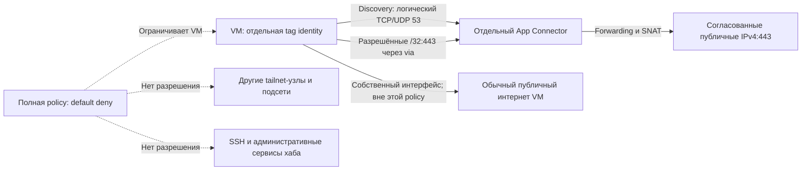

# Необязательный режим: VM только для AI-egress

## Назначение и статус

Режим нужен, когда VM имеет другого администратора с root, но должна использовать согласованный App Connector для HTTPS к Codex. Ей не требуется доступ к другим серверам, SSH хаба, IDE, внутренним proxy или подсетям tailnet.

Это **опциональная центральная настройка администратора Tailscale**. Обычный bootstrap не включает её автоматически. В текущем CLI нет отдельного флага изоляции, автоматического изменения policy или проверки полного набора grants. Появление этого документа не означает, что режим применён к конкретной VM: результат записывают отдельно в приватном акте.

Сетевую проверку выполнять вместе с [ACCEPTANCE](ACCEPTANCE.md), риски авторизации — по [SECURITY](SECURITY.md), завершение временного допуска — по [TEMPORARY-ACCESS](TEMPORARY-ACCESS.md).

## Что разрешается и что запрещается

| Поток | Результат режима |
| --- | --- |
| VM → согласованный connector: логический DNS discovery | Разрешён минимальный доступ TCP/UDP 53, обеспечивающий видимость PeerAPI |
| VM → согласованные публичные IPv4 `/32`: TCP 443 | Разрешён только через connector с выбранным тегом |
| VM → остальные tailnet-узлы и частные routed-подсети | Нет разрешающих grants/ACL |
| VM → SSH, IDE и административные сервисы хаба/connector | Нет разрешения; egress-доступ не даёт доступа к сервисам маршрутизатора |
| Остальные узлы → изолированная VM | Нет разрешения в этом профиле; иначе эти узлы могут оставаться видимыми VM |
| Прежние доверенные узлы → друг другу и прежним ресурсам | Доступ должен сохраниться и проверяется отдельно |
| VM → обычный публичный интернет через собственный интерфейс | Эта policy его не меняет и не блокирует |

«Только Codex» здесь означает **согласованные сетевые назначения**, а не распознавание процесса или HTTP-приложения. Любой процесс VM может использовать разрешённый IP/порт. Общий CDN-IP может обслуживать другие домены. Это свойство IP-маршрутизации App Connector; режима L7-фильтрации в проекте нет. [Ограничения общих IP](https://tailscale.com/docs/reference/best-practices/app-connectors).

## Почему одного узкого grant недостаточно

Разрешения ACL и grants складываются. Если оставить правило `src: ["*"], dst: ["*"], ip: ["*"]`, добавление ограничения для отдельного тега ничего не запретит. Также опасно включить изолированную VM в общее разрешение через `autogroup:tagged`, вторую доверенную tag identity, IP/CIDR или приложение с сетевыми полномочиями. Проверяют **всю** policy и все способы выбора источника/назначения. [Как складываются grants](https://tailscale.com/docs/features/access-control/grants/grants-explained).

Скрытие peer-узлов требует отдельной идентичности. Tailscale показывает устройства той же пользовательской identity даже без сетевых разрешений; показывает также устройства, способные подключаться к текущей VM. Поэтому ограниченной серверной VM назначают отдельный тег, например `tag:codex-egress-only`, и убирают разрешения как VM → peers, так и peers → VM. Назначение тега заменяет пользовательскую identity; основной хаб не тегируют ради этой операции. [Видимость устройств](https://tailscale.com/docs/concepts/device-visibility), [идентичность тегов](https://tailscale.com/docs/features/tags).



## Пример структуры policy

Ниже **схематичный пример**, а не готовая замена существующей policy. `192.0.2.42/32` — адрес TEST-NET; он не является реальным endpoint-ом и не подходит для рабочего профиля. Рабочие IP, ID устройств, user identities, private subnets и исходные настройки сохраняются вне Git.

```json
{
  "tagOwners": {
    "tag:ai-egress-hub": ["autogroup:admin"],
    "tag:codex-egress-only": ["autogroup:admin"]
  },
  "grants": [
    {
      "src": ["autogroup:member", "tag:ai-egress-hub"],
      "dst": ["autogroup:member", "tag:ai-egress-hub", "autogroup:internet"],
      "ip": ["*"]
    },
    {
      "src": ["tag:codex-egress-only"],
      "dst": ["tag:ai-egress-hub"],
      "ip": ["tcp:53", "udp:53"]
    },
    {
      "src": ["tag:codex-egress-only"],
      "dst": ["192.0.2.42/32"],
      "via": ["tag:ai-egress-hub"],
      "ip": ["tcp:443"]
    }
  ]
}
```

Первый grant показывает сохранение связности **доверенной** части. `autogroup:member` не заменяет перечень доверенных tagged devices. В реальном tailnet в обе стороны сохраняют все необходимые доверенные теги, shared identities и прежние approved private subnets отдельными подходящими правилами. Новые доверенные теги/подсети добавляют явно после проверки. Не подставлять `autogroup:tagged` для удобства: он включит и ограниченную VM. `autogroup:internet` не является разрешением к другим tailnet-устройствам. [Селекторы источников и назначений](https://tailscale.com/docs/reference/targets-and-selectors).

Остальные поля исходной policy — `ssh`, `nodeAttrs`, DNS/app mapping, существующие tests и прочие настройки — в этом фрагменте намеренно отсутствуют; их нельзя потерять при сборке полного кандидата. Отдельно проверяют правила Tailscale SSH: пользовательские разрешения не должны возвращать доступ ограниченной tag identity.

Второй grant даёт минимальную видимость connector для PeerAPI. Это логическое условие discovery, а не инструкция публиковать Docker-порт 53 или открывать все его административные порты. [Port access for DNS discovery](https://tailscale.com/docs/reference/best-practices/app-connectors#port-access-for-dns-discovery).

Третий grant связывает назначения с маршрутизатором через `via`. Доступ к connector не даёт сам по себе доступа к внешнему назначению. Разрешённые `/32`, фактические объявления, route approvals и маршруты клиента проверяют раздельно. Другой разрешающий grant без `via` может расширить выбор маршрутизатора. [Route filtering with Via](https://tailscale.com/docs/features/access-control/grants/grants-via), [route injection](https://tailscale.com/docs/reference/route-injection).

## Порядок включения без потери остальных доступов

1. **Сверить объекты.** Проверить ID, hostname, IPv4/IPv6 и текущую identity именно ограничиваемой VM. Отдельно сверить connector и основной хаб. У владельца должен оставаться независимый SSH/консольный доступ: этот режим не сохраняет управление VM по tailnet.
2. **Снять приватный baseline.** Сохранить исходную HuJSON policy с комментариями, её ETag, теги и key expiry VM, device inventory, approved routes, контрольные доступы доверенных узлов. Файлы держать root-owned `0600` в каталоге `0700`, без публикации секретов и рабочих адресов.
3. **Подготовить полный кандидат.** Заменить широкие разрешения на явные доверенные источники/назначения; сохранить их существующие связи. Добавить отдельный ограниченный тег и два разрешения egress. `tagOwners` оставить у администраторов. Не передавать API credentials на клиентскую VM.
4. **Проверить до записи.** Выполнить независимое ревью и серверную проверку полного кандидата. Встроенные policy tests должны содержать разрешённые и запрещённые потоки, включая IPv6 и регрессию доверенных пар. Если тест с ещё не назначенным тегом не моделирует реальную ноду, это записать и повторить после назначения; не выдавать пустое совпадение за успешную проверку.
5. **Применить с защитой от конкуренции.** Перечитать действующую policy и записывать кандидат только с точным `If-Match`. При изменившемся ETag остановиться, заново объединить изменения и повторить проверку. Затем перечитать результат и сравнить его с ожидаемым кандидатом.
6. **Назначить тег правильной VM.** Использовать сверенный device ID и административный API/консоль; проверить результат, отсутствие лишних доверенных тегов и неизменность key expiry. Не выполнять `logout`, `up --reset`, reauth или reboot ради смены тега.
7. **Принять фактический результат.** Повторить серверные тесты уже для реальной identity, проверить разрешения и netmap на самой VM, провести штатный `verify` и реальный запрос Codex. Проверить хаб и прежние доверенные соединения. Не считать успешную установку policy доказательством работающего Codex.

Если обновляются DNS-ответы, новые `/32` не добавляют автоматически ко всем разрешениям: сначала сверяют домен, публичный адрес и область route approval, затем повторяют приёмку. Широкие `/0`, новые exit nodes и частные подсети не являются штатным исправлением Codex-egress.

## Критерии приёмки

| Проверка | Требуемый результат |
| --- | --- |
| Identity VM | Назначен только ограниченный тег; прежняя user identity не используется для доступа |
| Полная policy | Нет другого разрешающего пути для VM через wildcard, trusted tag, IP/CIDR, ACL или SSH rule |
| Discovery | TCP/UDP 53 к согласованному connector разрешены; DNS выбранных FQDN работает |
| Egress | Каждый согласованный IPv4 `/32` разрешён на TCP 443 через нужный `via`; при семи утверждённых адресах проверены все семь |
| Прочие направления через tailnet | Нет разрешения к иным публичным назначениям, портам и маршрутизаторам |
| Другие узлы и подсети | Запрещены все порты/протоколы по policy для IPv4 и IPv6; реальными пробами проверены выбранные SSH/HTTPS/административные направления |
| Основной хаб и connector | SSH, IDE, внутренний CONNECT proxy и другие сервисы не разрешены VM; положительная проверка discovery не заменяет эти отрицательные проверки |
| Входящие соединения к VM | Другие peers не имеют разрешений к ней в этом профиле; обычный публичный доступ владельца сохранён |
| Видимость | После получения свежего netmap в `tailscale status` ожидается только нужный connector; дополнительные peers требуют объяснения и исправления |
| Рабочая сеть | Свежий `verify` прошёл, echo наблюдает согласованный egress, независимый обычный интернет VM остался прежним |
| Codex | Реальный ответ завершён; OAuth и streaming проверяются отдельно от правил сети |
| Регрессия | Прежние доверенные узлы продолжают обращаться к нужным сервисам; их теги, маршруты и входы не повреждены |

Формальный запрет всех портов проверяют полным набором правил и серверными tests; несколько runtime-проб не доказывают исчерпывающую проверку 65 тысяч портов. Если нет shell-доступа к VM, peer visibility и новый запрос Codex отмечают **непроверенными**, даже когда серверная policy принята. `NETWORK_VERIFIED` сам по себе не является проверкой изоляции.

## Откат и завершение допуска

При ошибке настройки egress не возвращать автоматически исходный `allow all`: это снова откроет VM путь к инфраструктуре. Сохранить ограниченную identity и запреты, затем исправить только недостающий разрешённый поток. Восстановление доверенных связей выполнять точечным кандидатом с ETag, серверной проверкой и регрессионными тестами. Снятие тега или возврат пользовательской identity может вернуть прежние полномочия — это отдельное решение владельца.

Для полного отключения VM удалить правильное устройство центрально и закрыть возможность повторной регистрации. Токены Codex отзываются отдельно. [Порядок временного допуска и очистки](TEMPORARY-ACCESS.md) не заменяется откатом `accept-routes`.

## Что этот режим не гарантирует

- Второй root по-прежнему контролирует локальные процессы и может копировать OAuth Codex. Сетевая изоляция не скрывает от него авторизацию и не отзывает прежние копии.
- Root может менять локальные настройки, выключить Tailscale и использовать обычный интернет. Постоянный fail-closed здесь не реализован.
- Удаление peers из свежего netmap не стирает уже известные адреса, сохранённый вывод или кэш другого администратора.
- Policy tailnet не закрывает публичные IP серверов и их публичные сервисы. Их защищают собственные firewall и аутентификация.
- Изоляция не делает общий connector и основной хаб разными физическими доверенными средами: контейнер использует ядро VPS.
- Новая регистрация под пользовательской identity либо выдача доверенного тега требует новой проверки. Один раз принятый профиль не является бессрочным доказательством изоляции.

Для более жёсткого разделения доверия использовать отдельный egress-tailnet и при необходимости отдельную VM-шлюз. Описанный здесь режим позволяет ограничить конкретную серверную identity внутри существующей сети, не делая его обязательным для всех новых узлов.
