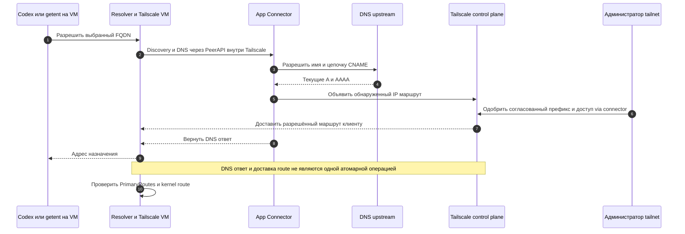
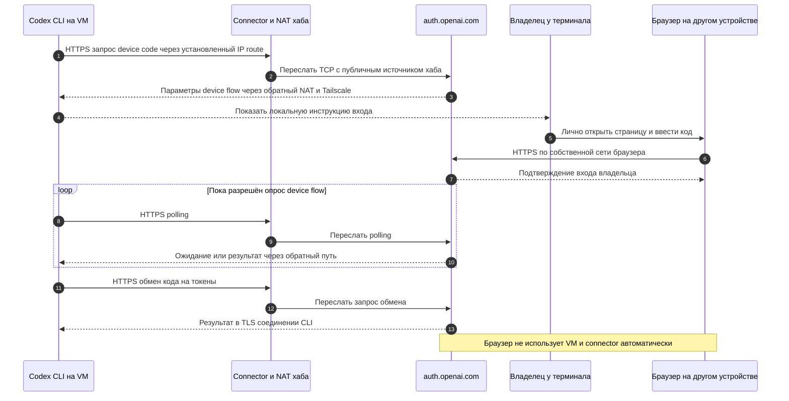
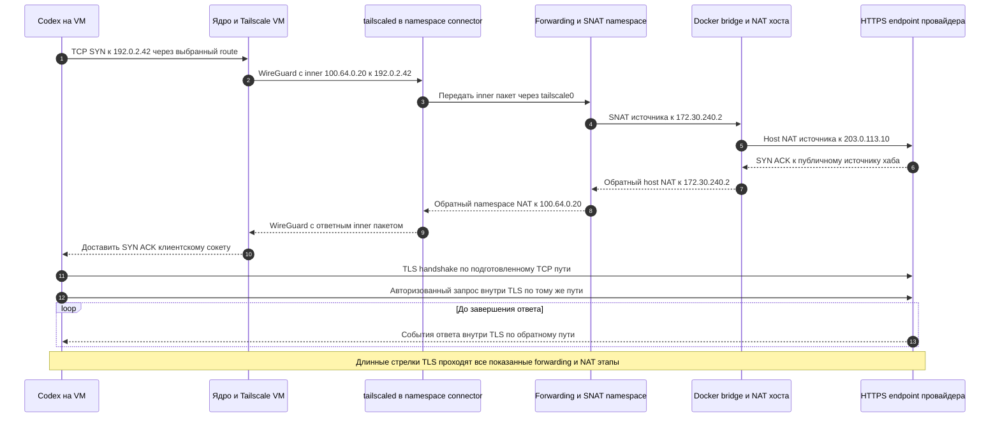
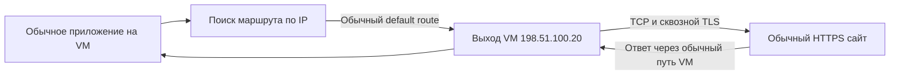
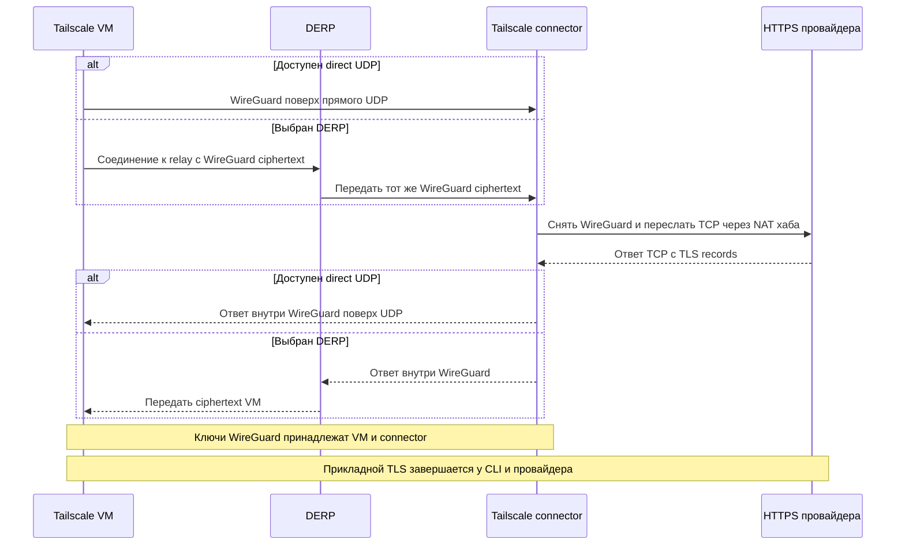
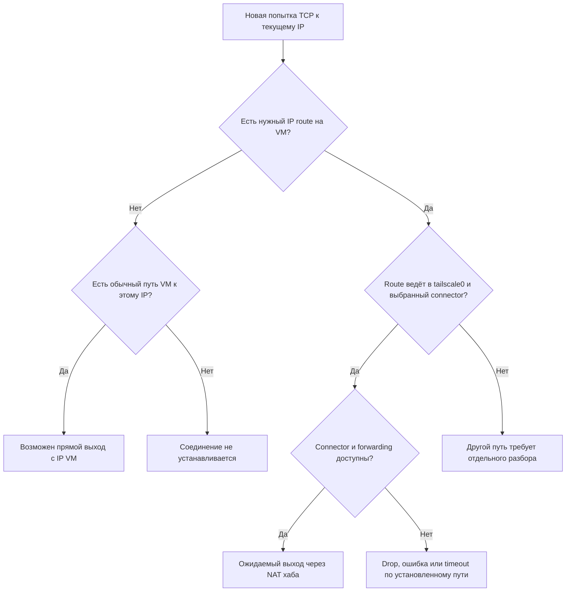

# Путь пакета: DNS, вход в Codex, запрос и отказы

Нативный Codex открывает HTTPS к провайдеру. App Connector добавляет путь **к IP назначения**, а Docker и хост хаба меняют исходный IP при выходе в интернет. TLS соединяет Codex и HTTPS endpoint провайдера. Ни connector, ни DERP не становятся сервером Codex или TLS proxy.

Здесь разобраны восемь сценариев для изолированного connector из [Docker Compose](../hub/compose.yaml). Архитектурные границы см. в [HLD](HLD.md), настройки и проверки — в [LLD](LLD.md), общий контекст — в [HLD/LLD пилота](HLD-LLD.md). Развёртывание описано в [ISOLATED-CONNECTOR](ISOLATED-CONNECTOR.md), критерии доказательства — в [ACCEPTANCE](ACCEPTANCE.md), отзыв доступа — в [SECURITY](SECURITY.md).

Это объяснение устройства и ожидаемого пути, а не публикация конфигурации или отчёт о работающей инфраструктуре. Установленный маршрут, DNS-ответ, тип транспорта и обе трансляции адреса проверяют наблюдением на конкретной установке.

## Адреса и слои в примерах

Все внешние адреса ниже взяты из **TEST-NET** и не предназначены для реальных соединений. Tailscale- и bridge-адреса также условны. Они не описывают чей-либо tailnet. Один адрес провайдера повторяется в независимых сценариях для читаемости; только сценарий 6 намеренно моделирует общий IP.

| Роль | Условное значение | Где используется |
| --- | --- | --- |
| VM, Tailscale IPv4 | `100.64.0.20` | Источник внутреннего пакета через `tailscale0` |
| Connector, Tailscale IPv4 | `100.64.0.10` | Идентичность peer, выбранного для маршрута, и `hub_ip` профиля |
| Публичный выход VM | `198.51.100.20` | Внешний Tailscale-транспорт и обычный прямой интернет VM |
| Публичный выход хаба | `203.0.113.10` | Внешний endpoint connector и ожидаемый выход к провайдеру |
| Connector, Docker bridge | `172.30.240.2/28` | Условный адрес `eth0` внутри отдельного network namespace |
| HTTPS endpoint провайдера | `192.0.2.42:443` | Условный результат A-записи в текущем сценарии |
| Отдельное устройство браузера | `198.51.100.30` | Его собственный публичный выход при device auth |
| DNS upstream и DERP | `DNS_UPSTREAM`, `DERP` | Символические назначения без адресов рабочей инфраструктуры |

`c` — временный TCP-порт клиента, `c1` и `c2` — его возможные отображения после NAT. NAT может сохранить порт. `u` и `v` — согласованные UDP-порты Tailscale, которые нельзя выводить из одного номера порта по умолчанию.

В документе различаются три слоя:

| Слой | Пример направления | Что находится внутри |
| --- | --- | --- |
| Внешний, или outer | `198.51.100.20:u → 203.0.113.10:v` | Зашифрованный WireGuard-пакет в прямом UDP-транспорте |
| Внутренний, или inner | `100.64.0.20:c → 192.0.2.42:443` | Исходный TCP-пакет приложения, до SNAT connector |
| Прикладной TLS | Codex ↔ `auth.openai.com` или `chatgpt.com` | HTTP-запросы, авторизация, текст запроса и события ответа |

**IP назначения inner-пакета — адрес провайдера, а не `100.64.0.10`.** Connector выбран как следующий Tailscale peer для этого IP. Отдельный DNS/discovery-запрос к peer и HTTPS-запрос к провайдеру — разные соединения.

## 0. DNS, discovery и одобрение маршрута

До первого HTTPS нужны согласованные app domains, доступ клиента к connector, разрешение application-трафика через него, одобренные маршруты и приём этих маршрутов Linux-клиентом. Добавление FQDN в локальный профиль bootstrap не меняет центральную policy.

1. Системный resolver VM передаёт выбранный app-домен механизму DNS Tailscale. В штатной схеме app domains создают специальное DNS-направление к connector.
2. Discovery использует PeerAPI. В документации Tailscale это DNS over HTTPS; в реализации PeerAPI обработчик формата RFC 8484 может работать как HTTP внутри уже зашифрованного WireGuard. Поэтому схема не предполагает отдельный TLS handshake к публичному DNS resolver. Указанные в пилотной policy `tcp:53`/`udp:53` обеспечивают нужную видимость peer, но не доказывают обычный DNS-пакет на `100.64.0.10:53`. Реальный PeerAPI-порт требует наблюдения. См. [реализацию RFC 8484 в PeerAPI](https://github.com/tailscale/tailscale/blob/445df50dcf76b6172dc4688c2097c47878f41641/ipn/ipnlocal/peerapi.go#L864-L915), [DNS discovery](https://tailscale.com/docs/features/app-connectors#dns-discovery-mechanism) и [доступ к discovery](https://tailscale.com/docs/reference/best-practices/app-connectors#port-access-for-dns-discovery).
3. Connector разрешает имя через свой доступный DNS upstream. Он изучает адреса, в том числе за CNAME, и объявляет маршруты. CNAME не доказывает, что приложение устанавливает HTTPS к имени alias target: HTTP hostname определяет сам клиент. См. [DNS lookups и CNAME](https://tailscale.com/docs/reference/best-practices/app-connectors#dns-lookups).
4. Объявленный маршрут должен быть разрешён центральной конфигурацией. В этом пилоте согласование ограничено точными префиксами. Новый IP вне согласованного набора не считается автоматически одобренным. Discovery, route approval и grant на HTTPS — отдельные условия.
5. Linux-клиент принимает одобренные app/subnet routes при `--accept-routes=true`. Bootstrap сначала сохраняет baseline и проверяет область **всех** предлагаемых маршрутов. Это не настройка «принимать только домены данного JSON».
6. До прикладного соединения нужны два согласованных наблюдения: текущий A имеет kernel route через `tailscale0`, а его точный `/32` в `PrimaryRoutes` принадлежит выбранному connector. Полученный DNS-ответ сам по себе их не заменяет.

| Наблюдаемый участок | Источник → назначение | Что доказано и что остаётся проверить |
| --- | --- | --- |
| Локальный вызов resolver | Процесс VM → системный resolver | Это может быть локальный IPC или cache hit, отдельного сетевого пакета может не быть |
| Discovery в overlay | VM `100.64.0.20` → peer `100.64.0.10` | DNS/discovery внутри Tailscale, точный PeerAPI-порт требует наблюдения |
| Выход DNS из namespace | `172.30.240.2` → `DNS_UPSTREAM` до host NAT | Фактический протокол и источник зависят от resolver, Docker DNS и версии Tailscale |
| Доставка маршрута | Control plane → Tailscale VM | Конфигурация маршрута, а не пересылка текста запроса к модели |
| Результат выбора пути | `100.64.0.20` → `192.0.2.42` через `tailscale0` | Только после установки нужного маршрута, до NAT |

В [Compose](../hub/compose.yaml) DNS upstream контейнера задаются явно и должны разрешать app domains независимо от host MagicDNS. Иначе возможен цикл «connector → host DNS → тот же connector». `--accept-dns=false` у контейнерного daemon не исправляет унаследованный Docker upstream. Внутренний Docker DNS может пересылать запросы сам, поэтому таблица не утверждает, что каждый upstream DNS-пакет имеет источник контейнера. Нужны проверка `HostConfig.Dns` и запрос из того же namespace, как описано в [ISOLATED-CONNECTOR](ISOLATED-CONNECTOR.md).

IPv4-приёмка проверяет также AAAA и наличие IPv6 default. Доступный или неизвестный публичный IPv6-путь требует отдельного решения: отсутствие IPv6 forwarding в контейнере не закрывает прямой IPv6 VM.

## 1. Device auth: CLI на VM, браузер на другом устройстве

Команда `login` в [cli.py](../src/tailnet_bootstrap/cli.py) после свежего `verify` запускает `codex login --device-auth`. У неё две независимые сетевые стороны: CLI на VM получает и опрашивает device flow, владелец подтверждает его в своём браузере.

Для версии `0.172.0` CLI использует пути `/api/accounts/deviceauth/usercode`, `/api/accounts/deviceauth/token` и `/oauth/token` относительно issuer `auth.openai.com`. Браузерная страница подтверждения — `/codex/device`. Это пути внутри HTTPS, а не отдельные DNS-записи или IP-маршруты.

1. CLI разрешает `auth.openai.com`. При уже принятом маршруте к текущему IP его TCP SYN идёт через Tailscale на connector.
2. Connector снимает WireGuard-обёртку и пересылает TCP-пакет, сохраняя TLS до провайдера. Адрес источника меняют NAT внутри namespace и NAT Docker на хосте, подробно в сценарии 2.
3. CLI получает device code и показывает инструкцию. Владелец вводит код на собственном устройстве. Браузер обращается к странице подтверждения по **своему** маршруту. Он может использовать внешнего identity provider, SSO и дополнительные browser-only домены.
4. CLI продолжает polling к `auth.openai.com`, затем выполняет обмен авторизации. Браузер не пересылает токен в CLI через SSH: результат получает сам штатный device flow.
5. Позднейшее обновление авторизации также может обращаться к issuer. Поэтому успешный login не означает, что домен авторизации больше не нужен.

| Соединение | До NAT / внутренний пакет | На публичной стороне назначения | TLS endpoint |
| --- | --- | --- | --- |
| CLI device code / polling / обмен | `100.64.0.20:c → 192.0.2.42:443` | `203.0.113.10:c2 → 192.0.2.42:443` | CLI ↔ `auth.openai.com` |
| Браузерное подтверждение | Сеть отдельного устройства, вне VM | `198.51.100.30:c → 192.0.2.42:443` | Браузер ↔ `auth.openai.com` |
| Ответ CLI после обратных NAT | `192.0.2.42:443 → 100.64.0.20:c` | Входящий ответ сначала адресован `203.0.113.10:c2` | Тот же CLI TLS-сеанс |

Провайдер может видеть разные исходящие IP у CLI и браузерного входа. Выбор маршрута VM не делает их одинаковыми. Подключение Tailscale для браузера, exit node или его proxy были бы отдельной настройкой другого устройства и здесь не предполагаются.

Для закреплённого Codex `0.172.0` дефолтный issuer и device flow подтверждаются официальными исходниками: [issuer](https://github.com/openai/codex/blob/rust-v0.172.0/codex-rs/login/src/server.rs#L78), [device code, polling и обмен](https://github.com/openai/codex/blob/rust-v0.172.0/codex-rs/login/src/device_code_auth.rs), [обновление токенов](https://github.com/openai/codex/blob/rust-v0.172.0/codex-rs/login/src/auth/manager.rs#L1906). Коды, URL входа, токены и файлы авторизации не нужны для сетевого отчёта и не публикуются.

## 2. Текстовый запрос и поток ответа

После входа через подписку ChatGPT стандартный backend закреплённой версии — `https://chatgpt.com/backend-api/codex`. Клиент может запросить каталог моделей и открыть inference/streaming к `/responses`. Это другой HTTPS host относительно `auth.openai.com`, поэтому его текущие DNS-адреса и маршруты проверяются отдельно. См. [выбор backend](https://github.com/openai/codex/blob/rust-v0.172.0/codex-rs/model-provider-info/src/lib.rs#L475) и [каталог моделей](https://github.com/openai/codex/blob/rust-v0.172.0/codex-rs/codex-api/src/endpoint/models.rs).

### Прямой и обратный путь

1. Ядро VM выбирает маршрут по IP назначения. При обычном выборе source для этого route inner-пакет имеет источник `100.64.0.20` и назначение `192.0.2.42:443`. Фактический source сверяют с `ip route get` и заголовками пакетов, особенно при явном bind клиента или иной policy routing.
2. Tailscale шифрует inner-пакет ключами VM и connector. Внешний пакет доходит до daemon **контейнера** напрямую или через relay. Хостовый `tailscaled` с другой идентичностью не нужен как промежуточный peer.
3. Daemon контейнера снимает WireGuard-обёртку. В его отдельном network namespace пакет выходит из `tailscale0`, проходит forwarding и штатный SNAT Tailscale к адресу исходящего интерфейса, здесь `172.30.240.2`.
4. Пакет пересекает `eth0`/veth контейнера и Docker bridge. Хост выполняет следующую трансляцию источника к адресу своего внешнего интерфейса, здесь `203.0.113.10`, и отправляет пакет провайдеру.
5. Ответ провайдера приходит на публичный адрес хаба. Conntrack хоста восстанавливает назначение `172.30.240.2:c1`. Conntrack namespace восстанавливает `100.64.0.20:c`. Обратный маршрут в namespace ведёт в Tailscale, где ответ снова шифруется до VM.
6. После TCP handshake CLI устанавливает TLS с провайдером, проверяет его сертификат и передаёт запрос. Ответный поток идёт по уже открытому соединению либо по дополнительным соединениям самого клиента. Текст ответа расшифровывает CLI. ACK, retransmit и FIN/RST проходят те же соответствующие трансляции.

### Заголовки на границах

Таблица описывает ожидаемую модель **двух SNAT** при стандартных настройках. TCP-порт назначения остаётся `443`.

| Шаг и точка наблюдения | Слой | Источник → назначение | Изменение и содержимое |
| --- | --- | --- | --- |
| 1. `tailscale0` VM, исходящий | Inner TCP | `100.64.0.20:c → 192.0.2.42:443` | TCP SYN, затем TLS records |
| 2. Публичная сеть VM → хаб при direct | Outer UDP | `198.51.100.20:u → 203.0.113.10:v` | WireGuard скрывает inner IP/TCP и TLS records от транзитной сети |
| 3. `tailscale0` namespace после расшифрования | Inner TCP | `100.64.0.20:c → 192.0.2.42:443` | Исходный IP-пакет восстановлен, содержимое приложения ещё защищено TLS |
| 4. `eth0` namespace → Docker bridge | TCP после первого SNAT | `172.30.240.2:c1 → 192.0.2.42:443` | Tailscale masquerade заменил source, TLS не терминирован |
| 5. Внешний интерфейс хаба → провайдер | TCP после второго SNAT | `203.0.113.10:c2 → 192.0.2.42:443` | Host/Docker NAT заменил source второй раз |
| 6. Ответ на внешний интерфейс хаба | TCP | `192.0.2.42:443 → 203.0.113.10:c2` | Провайдер отвечает наблюдаемому источнику TCP |
| 7. Docker bridge → `eth0` namespace | TCP после обратного host NAT | `192.0.2.42:443 → 172.30.240.2:c1` | Отменено отображение host NAT |
| 8. Namespace → `tailscale0` | Inner TCP после обратного SNAT Tailscale | `192.0.2.42:443 → 100.64.0.20:c` | Восстановлено назначение VM |
| 9. Публичная сеть хаб → VM при direct | Outer UDP | `203.0.113.10:v → 198.51.100.20:u` | Обратный inner-пакет внутри WireGuard |
| 10. Сокет Codex на VM | Inner TCP и TLS | `192.0.2.42:443 → 100.64.0.20:c` | CLI получает и расшифровывает прикладные события |

На внешнем Tailscale-транспорте контейнера Docker может отдельно менять UDP-адреса и порты. Строки 2 и 9 показывают вид с публичной сети, а строки 4–8 — прикладной TCP после снятия WireGuard. Это разные потоки conntrack.

Основание для модели: [Compose](../hub/compose.yaml) задаёт kernel TUN `tailscale0`, bridge и namespaced `ip_forward=1`; [команды регистрации](ISOLATED-CONNECTOR.md) не отключают subnet SNAT. [Tailscale документирует SNAT по умолчанию](https://tailscale.com/docs/reference/troubleshooting/network-configuration/disable-subnet-route-masquerading), а [Docker bridge](https://docs.docker.com/engine/network/drivers/bridge/) — маскировку внешнего трафика контейнеров. Поэтому ожидается `100.64.0.20 → 172.30.240.2 → 203.0.113.10`.

**Это вывод из конфигурации и стандартного поведения, а не доказательство конкретных правил любой установки.** Для подтверждения нужны правило masquerade Tailscale в namespace, host masquerade bridge-подсети и сопоставленные заголовки на `tailscale0`, `eth0`, bridge и внешнем интерфейсе. В iptables backend Tailscale может использовать `POSTROUTING → ts-postrouting → MASQUERADE` для помеченного forwarded-пакета, а Docker — правило `MASQUERADE` для исходящей bridge-подсети. Имена chains и backend нужно устанавливать на месте: отсутствие цепочки в выводе `iptables-nft` не доказывает её отсутствия в `iptables-legacy`, и наоборот. Иные backends, отключённый masquerade, изменённый SNAT или дополнительный NAT провайдера могут изменить детали. HTTPS echo отдельно подтверждает внешний адрес своего соединения.

### Что означает streaming

В клиенте присутствуют HTTP/SSE и WebSocket пути: [Responses HTTP](https://github.com/openai/codex/blob/rust-v0.172.0/codex-rs/core/src/client.rs#L2087), [Responses WebSocket](https://github.com/openai/codex/blob/rust-v0.172.0/codex-rs/codex-api/src/endpoint/responses_websocket/connector.rs#L25). Какой из них выбран конкретным запуском, зависит от версии, конфигурации и серверного поведения.

| Вариант | Прикладное соединение | Что остаётся прежним в packet walk |
| --- | --- | --- |
| HTTP/SSE | HTTPS-запрос и поток событий ответа | DNS host, TCP 443, route, WireGuard и NAT |
| WSS | TLS-соединение и WebSocket handshake, затем frames | Тот же host и TCP 443, длительное соединение, тот же сетевой путь |

Нельзя по открытому TCP 443, строке «streaming» в UI или полному тексту ответа определить SSE/WSS. Для этого нужно безопасное штатное событие клиента или иное наблюдение согласованного протокола. Ошибка WSS не гарантирует переход на работающий SSE: fallback зависит от реализации и вида ошибки. Проверять нужно успешное завершение реального потока, включая handshake и длительность соединения.

`api.openai.com` — другой backend, в частности для API-режима, и не становится обязательным только из-за запроса через подписку ChatGPT. Явный provider/base URL, корпоративный issuer, дополнительные инструменты или иной режим требуют собственного инвентаря endpoint-ов. URL path `/backend-api/codex` не является отдельным DNS-маршрутом: App Connector знает IP, а path защищён TLS.

## 3. Обычный не-AI трафик выходит напрямую

Предположим, обычный сайт в этом независимом примере разрешился в `192.0.2.42` и **для этого IP нет** установленного connector route. Ядро выбирает обычный default route VM.

1. Приложение разрешает имя и открывает сокет к полученному IP.
2. Route lookup выбирает обычный интерфейс VM, а не `tailscale0`.
3. Сайт видит публичный выход VM `198.51.100.20`. Если VM находится за NAT облака, её локальный source может быть другим; таблица показывает публичную границу.
4. Ответ идёт обратно через обычную сеть VM. Connector, его bridge и NAT хаба в соединении не участвуют.

| Участок | Источник → назначение | Обёртки |
| --- | --- | --- |
| Route lookup VM | Фактический source обычного интерфейса → `192.0.2.42:443` | Обычный TCP, затем TLS |
| Публичная сторона VM | `198.51.100.20:c → 192.0.2.42:443` | TLS без WireGuard данного connector |
| Ответ публичной стороне VM | `192.0.2.42:443 → 198.51.100.20:c` | Обратный обычный TCP/TLS |

В [network.py](../src/tailnet_bootstrap/network.py) независимый non-AI контроль разрешается отдельно, проверяется отсутствие пути через `tailscale0`, затем HTTPS echo должен показать адрес, отличный от ожидаемого выхода хаба. Имя вне `domains` само по себе прямой путь не гарантирует: сценарий 6 показывает исключение с общим IP.

## 4. Direct Tailscale и DERP: меняется внешний путь

Прямое соединение Tailscale означает UDP-транспорт **VM ↔ connector**, а не прямой выход VM к OpenAI. Если UDP/NAT traversal недоступен, Tailscale может использовать DERP. При наличии отдельно настроенного peer relay возможен и он.

| Путь | Внешние направления | Inner-пакет и выход к провайдеру |
| --- | --- | --- |
| Direct | `198.51.100.20:u → 203.0.113.10:v`, UDP | `100.64.0.20:c → 192.0.2.42:443`, затем два SNAT из сценария 2 |
| DERP | VM `198.51.100.20` → `DERP`, connector через хаб `203.0.113.10` → `DERP`, обычно TCP/TLS 443 | Тот же inner-пакет, расшифровываемый только на connector, затем тот же выход хаба |

Обе стороны устанавливают свои соединения к DERP. Стрелка relay → connector на диаграмме означает передачу данных по существующему транспортному соединению. Она не предполагает новый произвольный входящий TCP в контейнер или опубликованный Docker port.

DERP пересылает уже зашифрованные WireGuard-пакеты и не получает plaintext inner IP-пакета или запроса Codex. На connector снимается WireGuard, но TLS приложения сохраняется. Relay может изменить задержку, пропускную способность и устойчивость длительного потока. Он не меняет выходной публичный IP прикладного соединения при неизменном connector/NAT. См. [типы соединений](https://tailscale.com/docs/reference/connection-types), [шифрование](https://tailscale.com/docs/concepts/tailscale-encryption) и [протокол DERP](https://github.com/tailscale/tailscale/blob/main/derp/README.md).

Тип текущей связи подтверждают `tailscale ping`/`tailscale status` для нужного peer. Только отсутствие direct ещё не означает сетевой отказ. Ни bootstrap, ни эта схема не гарантируют, что DERP будет доступен в любой сети.

## 5. Маршрут исчез, новый DNS IP не одобрен или connector недоступен

Здесь важна разница между **отсутствующим** маршрутом и **сохранившимся, но непроходимым** маршрутом. Смена состояния connector не означает автоматически одинаковый результат на каждом клиенте.

| Событие | Route lookup и пакет | Возможный результат |
| --- | --- | --- |
| Connector route снят | Новый SYN к `192.0.2.42` может выбрать обычный default | На публичной стороне `198.51.100.20:c → 192.0.2.42:443`, то есть direct bypass |
| DNS вернул новый, ещё не одобренный IP | Для нового IP может не оказаться подходящего `/32` через connector | После получения/сохранения такого DNS-ответа приложение может попробовать обычный выход VM |
| Connector потерял связь, но route сохранён | SYN выбирает `tailscale0`, inner source `100.64.0.20`, доставить пакет не удаётся | Ошибка/timeout, без автоматического переключения этого route на обычный default |
| Истёк ключ connector и маршруты сохранены Tailscale | Установленный маршрут остаётся непроходимым | Для этого состояния Tailscale описывает сохранение routes, чтобы избежать утечки |
| DNS discovery не может получить ответ | Нового IP у приложения нет | Возможна ошибка DNS ещё до SYN, если нет пригодного cache |

Новый неразрешённый маршрут не обязан приводить к утечке: DNS может завершиться ошибкой, широкий маршрут может уже покрывать IP или приложение не начнёт соединение. Но запрета direct bootstrap не устанавливает, поэтому гарантировать его отсутствие нельзя. Для оставшегося непроходимого route ядро обычно не перебирает менее специфичный default как замену неответившему peer. [Tailscale отдельно описывает сохранение routes при истёкшем ключе](https://tailscale.com/docs/features/app-connectors#expired-device-keys).

У уже открытого TCP при смене пути могут измениться внешний source/NAT mapping и доступность обратного пути. Такое соединение часто прерывается. Нельзя обещать его бесшовный перенос на другой выход. Оценивать риск direct нужно также для **нового** соединения или повторной попытки клиента.

`verify` при новом запуске обнаруживает несогласованные текущие DNS/routes и возвращает блокеры. `login`/`launch` требуют успешный свежий `verify` до старта, но после старта bootstrap не следит непрерывно за каждым пакетом. Он не создаёт firewall kill switch. **Строгий fail-closed этим проектом не реализован и не принят.** Для его добавления нужны отдельная архитектура, явное enforcement и собственная проверка отказов.

## 6. Общий CDN IP и маршрутизация всех процессов

Теперь два разных имени намеренно имеют один A-адрес `192.0.2.42`: `chatgpt.com` в пилотном списке и условный обычный сайт вне него. Если `/32` к этому IP принят через connector, он применяется к обоим назначениям.

1. Codex разрешает `chatgpt.com` в общий IP и открывает HTTPS.
2. Другой процесс VM разрешает обычный сайт в тот же IP, либо использует адрес без DNS.
3. Для обоих пакетов ядро видит один IP назначения и выбирает один маршрут. Имя процесса, HTTP Host, URL path и список `domains` не служат условиями route lookup.
4. Текущий grant/firewall может разрешить или запретить конкретный протокол/порт. Но при разрешённом TCP 443 он не превращается в фильтр HTTP hostname.

| Приложение | Inner до NAT | Публичный source после NAT | Что маршрутизатор использует для выбора пути |
| --- | --- | --- | --- |
| Codex → `chatgpt.com` | `100.64.0.20:c → 192.0.2.42:443` | `203.0.113.10` | IP назначения и текущие правила маршрутизации |
| Другой процесс → обычный сайт на том же IP | `100.64.0.20:c → 192.0.2.42:443` с другим клиентским портом | `203.0.113.10` | Тот же `/32`, несмотря на другое имя |

Поэтому формулировка «выбранные домены через хаб» означает DNS-поддерживаемый набор **IP-маршрутов для всех процессов VM**. Она не обещает «только процесс Codex» или «другие домены всегда напрямую». Это свойство [App Connector](https://tailscale.com/docs/features/app-connectors#considerations), а не дефект TLS. Адрес canary также проверяется отдельно: его успешный SNAT не доказывает ни маршрут другого CDN IP, ни адрес, наблюдаемый OpenAI.

## 7. Отзыв доступа и остановка соединений

Полная процедура временного допуска описана в [TEMPORARY-ACCESS](TEMPORARY-ACCESS.md), границы полномочий и обращение с учётными данными — в [SECURITY](SECURITY.md). Здесь показано, какой именно слой затрагивает действие, чтобы сетевой rollback не принять за отзыв аккаунта.

| Действие уполномоченного владельца | Как меняется путь новых пакетов | Чего действие само по себе не подтверждает |
| --- | --- | --- |
| Отзыв grant к приложению через connector | Передача к выбранному IP/порту через tailnet может быть запрещена после применения policy | Запрет обычного прямого интернета VM и отзыв токенов провайдера |
| Центральное удаление сверенного pilot-device | Отзывается Tailscale-доступ именно временной VM после распространения изменения | Отзыв OpenAI OAuth, SSH на публичном интерфейсе и запрет новой регистрации |
| Отзыв route approval или app-domain mapping | Connector route может исчезнуть, последующие попытки могут выбрать default VM | Fail-closed, см. сценарий 5 |
| Остановка connector или отзыв его Tailscale-доступа | Путь через peer перестаёт работать, судьба route зависит от состояния control plane/клиента | Мгновенное закрытие всех сокетов и отсутствие обходного пути |
| Клиентский `rollback` | Восстанавливается только сохранённое `accept-routes`, если проверки идентичности разрешают | Удаление Tailscale-ноды, программ или входа Codex |
| Штатный отзыв авторизации Codex/аккаунта | Провайдер отклоняет операции согласно своей механике сессий и токенов | Отключение сети, connector или Tailscale identity |

При завершении временной работы администратор удаляет центрально **только сверенное устройство pilot VM**, созданное для этой задачи. Общий хаб и shared connector сохраняют, как и их маршруты/mapping для остальных клиентов. Остановка общего connector в таблице описывает влияние на сеть, а не обычный способ отзыва одной VM. Локальный `tailscale logout` не заменяет центральное удаление; проверяют также выданные средства регистрации и возможность повторного входа.

Для закрытия доступа политикой нужно устранить **все разрешающие пути**: сузить или удалить каждый grant и ACL, который разрешает нужный поток. Узкий grant, в том числе с `via`, не отменяет широкое разрешение из другого grant или `acls`. После изменения проверяют эффективную policy, новые соединения и независимые сервисные доступы. Tailnet policy сама по себе не закрывает публичный SSH или обычный прямой интернет VM.

Проверяют отдельно прекращение требуемого доступа, новые соединения и судьбу существующего потока. Не следует выводить немедленное завершение уже открытого TCP/TLS только из изменения policy или истечения ключа. Если цель — остановить работу, сначала прекращают клиентский трафик по процедуре владельца, затем отзывают соответствующие доступы и проверяют результат. Удаление локального файла не заменяет серверный отзыв авторизации.

## Как сопоставить объяснение с реализацией

| Утверждение | Проверяемое основание |
| --- | --- |
| Bootstrap меняет приём маршрутов только на VM | [network.py](../src/tailnet_bootstrap/network.py): `capture_baseline`, `apply_client`, `rollback`; единственная сетевая mutation — `tailscale set --accept-routes=...` |
| Проверяется конкретный connector для каждого текущего A | Там же: `_dns`, `_route`, `verify`, точный `/32` в `PrimaryRoutes` и route через `tailscale0` |
| HTTPS canary отправляется только после успешных prerequisites | Там же: `_probe` закрепляет проверенный A через `curl --resolve`, `verify` сопоставляет echo и non-AI контроль |
| Успех canary не равен приёмке Codex | [cli.py](../src/tailnet_bootstrap/cli.py): `check_network` пишет `codex_acceptance: NOT_TESTED`, `codex_action` оставляет `MANUAL_VERIFICATION_REQUIRED` |
| Connector имеет отдельную идентичность и namespace | [Compose](../hub/compose.yaml) и [ISOLATED-CONNECTOR](ISOLATED-CONNECTOR.md): отдельный state/socket, bridge, kernel TUN, namespaced forwarding |
| TLS остаётся между CLI и провайдером | Конфигурация не устанавливает TLS proxy или CA перехвата; packet walk предусматривает forwarding и NAT |
| Точный SSE/WSS и две трансляции нельзя вывести из `NETWORK_VERIFIED` | [ACCEPTANCE](ACCEPTANCE.md): требуется реальная операция и наблюдение endpoint-ов; проверки клиента не инспектируют namespace NAT хаба или согласованный streaming protocol |

Для приёмки достаточно несекретных фактов: версия клиента, время, FQDN, текущие адреса и выбранные routes в приватном отчёте, тип подтверждённого транспорта, результат handshake и завершения ответа. Если какого-то наблюдения нет, оно остаётся непроверенным. Сетевые capture и netfilter dumps могут раскрывать инфраструктуру даже без TLS plaintext: их не прикладывают к публичному репозиторию целиком и не включают payload, заголовки авторизации, коды входа или токены.
