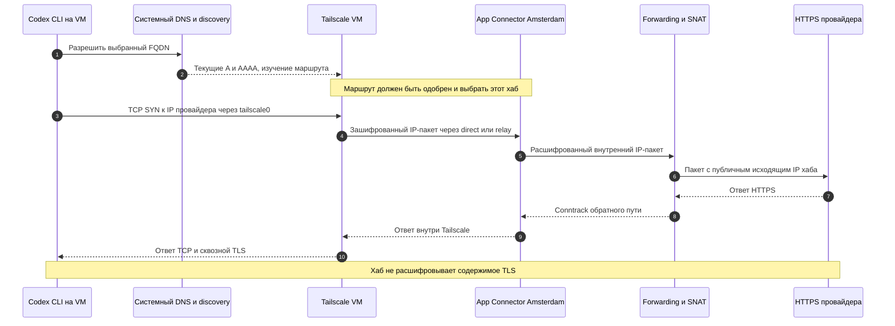
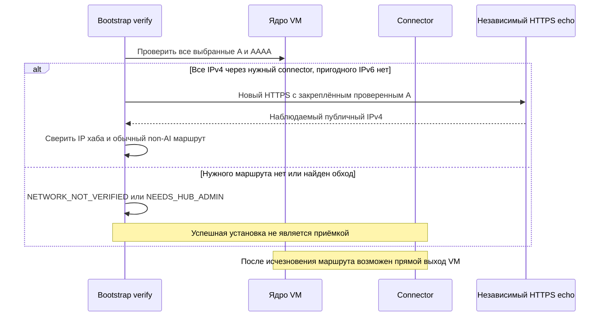

# Packet flow

## Обычный HTTPS через подготовленный маршрут

Codex видит обычный HTTPS и системный DNS. Смена IP происходит на сетевом уровне хаба (SNAT), а не в TLS. Внутренний адрес VM автоматически в заголовок HTTPS не добавляется. У провайдера могут быть дополнительные признаки учётной записи и клиента; контрольный IP echo не даёт доступа к его внутренним журналам.

## Отказ и контроль

Проверка закреплённого A устанавливает путь к конкретному адресу. Дополнительный обычный запрос без закрепления и реальный Codex нужны, чтобы проверить участие системного resolver и текущее множество доменов приложения. Отсутствие прямого Tailscale-соединения не обязательно означает отказ: возможен DERP/peer relay с другой задержкой.

Обычный non-AI endpoint должен использовать прямой интернет VM. Исчезновение маршрута, DNS/DoH в приложении и новые CDN-адреса рассматриваются отдельно; текущий пилот не устанавливает firewall kill switch.
