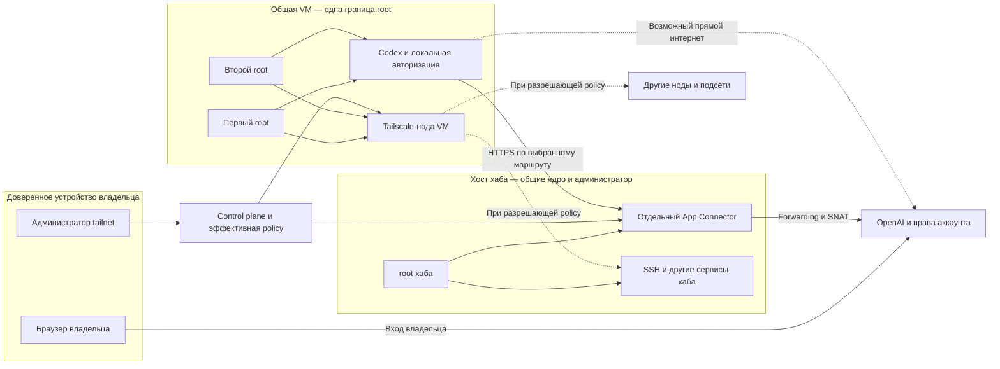

# Модель угроз и отзыв доступа

Если два человека имеют полный root/sudo на одной VM, оба входят в одну границу доверия. Второй администратор технически может использовать локальную авторизацию Codex, читать данные VM, менять её маршруты и действовать от имени зарегистрированной Tailscale-ноды. Отдельный App Connector ограничивает одну сетевую роль; фактический доступ к хабу и остальному tailnet определяется всей действующей политикой и защитой сервисов.

Это общая модель для архитектуры репозитория, а не акт аудита конкретного tailnet, VM или аккаунта. Наличие файла не подтверждает применение рекомендуемых ограничений или отзыв доступа. Параметры реального окружения и результаты проверок хранятся в приватном отчёте. Имена тегов с `-example` ниже условные. Официальные источники проверены 25 ноября 2026 года; интерфейсы и поведение иных версий требуют повторной проверки.

## Границы доверия

Пунктирные связи показывают проверяемые возможности, а не установленный факт доступа. TLS штатного Codex завершается у провайдера; обычный forwarding/SNAT сам по себе не расшифровывает HTTPS. Полный root на конечной VM может менять клиент, доверенные CA, окружение и процессы, поэтому защита TLS от промежуточного узла не защищает от администратора самого клиента.

Linux разделяет привилегии root на capabilities, включая обход файловых ограничений и управление процессами. Для рассматриваемого полного root права `0700/0600`, отдельный Unix-пользователь, другой `CODEX_HOME`, tmux и локальные проверки bootstrap не создают границу секретности. Эти меры полезны против непривилегированного доступа и ошибок. Источник: [Linux capabilities(7)](https://man7.org/linux/man-pages/man7/capabilities.7.html).

## Возможности второго root

| Что он технически может сделать | Необходимые условия | Что ограничивает ущерб |
| --- | --- | --- |
| Запускать уже авторизованный Codex, расходовать доступные лимиты, читать локальные проекты и историю, менять команды | Авторизация или активный процесс доступны на общей VM | Собственный аккаунт каждого человека; личная авторизация только в VM, где чужого root нет |
| Скопировать локальные OAuth-данные или состояние Tailscale для последующего использования | Данные находились на подконтрольной ему VM | Считать их потенциально раскрытыми; отзывать серверную авторизацию и ноду, а не ограничиваться удалением файлов |
| Обращаться к портам хаба и других нод, включая одобренные подсети | Это разрешено эффективными ACL/grants; цель достижима и принимает соединения | Узкие разрешения источника, firewall цели, независимая аутентификация сервисов |
| Получить shell/root на хабе или другой ноде | Дополнительно нужны подходящие сервисные права, уязвимость или ошибка настройки | Ключи/пароли/роли сервисов, обновления, отсутствие лишних слушающих портов; разрешённый TCP не равен shell |
| После захвата root хаба получить доступ к host Tailscale state, контейнерам, данным и сетевым настройкам | Сначала скомпрометирован сам хост | Отдельная VM для connector уменьшает общую область компрометации; контейнер на том же хосте не защищает от host root |
| Менять центральную policy, теги или регистрировать новые устройства | Нужны соответствующие административные/регистрационные полномочия либо их раскрытые credentials | Отдельные админские аккаунты, узкие `tagOwners`, контроль регистрации и device approval |
| Обходить локальные настройки маршрута, останавливать daemon, выходить в интернет напрямую | У человека остаётся root и обычный интернет VM | Ограничения за пределами контролируемой им VM; отзыв OpenAI отдельно от Tailscale |

Полномочия root VM сами по себе не выдают административную роль Tailscale или пароль OpenAI. Ключи этой ноды также не являются ключами всех остальных нод. Но регистрация общей VM под пользовательской идентичностью владельца может дать ей сетевые разрешения, предназначенные для его личных устройств.

В варианте [ISOLATED-CONNECTOR.md](ISOLATED-CONNECTOR.md) отдельные daemon, state и network namespace сохраняют отдельную идентичность connector. Хост остаётся общим: владелец Docker daemon может управлять контейнером и его файловыми монтированиями. Это не доказательство запрета клиенту обращаться к сервисам хоста; такой запрет проверяется отдельно. Источник: [Docker Engine security](https://docs.docker.com/engine/security/).

## Как оценить реальную область сетевого доступа

Маршрут отвечает на вопрос «куда отправится пакет», grant — «разрешено ли соединение». Нужны оба условия; установленный маршрут не доказывает разрешение, а grant не создаёт маршрут. Источник: [Tailscale route injection](https://tailscale.com/docs/reference/route-injection).

Каждый grant добавляет разрешения. Более узкий grant, включая `via`, не отменяет широкое разрешение из другого grant или старого `acls`: Tailscale оценивает их совместно. Чтобы закрыть доступ, нужно сузить или убрать каждое правило, которое его разрешает. Источник: [Grants explained](https://tailscale.com/docs/features/access-control/grants/grants-explained).

Например, общий шаблон `{"src":["*"],"dst":["*"],"ip":["*"]}` разрешает соединения ко всем Tailscale-адресам и одобренным subnet routes на всех протоколах/портах. Добавление рядом узкого правила для Codex не изолирует пилот. Это пример опасного сочетания, а не опубликованная конфигурация окружения. Источники: [Wildcard selectors](https://tailscale.com/docs/reference/targets-and-selectors#wildcard-selectors), [Allow all example](https://tailscale.com/docs/reference/examples/grants#allow-all).

Администратор проверяет полный экспорт действующей policy и инвентарь устройств в приватной среде:

1. **Идентичность источника.** Сопоставить конкретную pilot-ноду, владельца, все теги и действующую регистрацию. Тег заменяет пользовательскую идентичность; разрешения нескольких тегов объединяются. Назначение `tag:pilot-example` имеет смысл только вместе с пересмотром всей policy. Не переводить существующий общий хаб на тег без оценки прежних доступов. Источник: [Tags: identity and ownership](https://tailscale.com/docs/features/tags).
2. **Право назначать теги.** Определить `tagOwners` и доверенных назначающих; не давать пилотной ноде владение более привилегированными тегами. Полный root клиента не отменяет центральные ограничения назначения. Владелец тега и получатель сетевого доступа — разные роли. Синтаксис и допустимые селекторы: [Policy file: tag owners](https://tailscale.com/docs/reference/syntax/policy-file#tag-owners).
3. **Три условия App Connector.** Отдельно проверить domain mapping в `nodeAttrs.app`, discovery к connector (`tcp:53`/`udp:53`), доступ к IP назначения приложения. `nodeAttrs.target` распространяет конфигурацию приложения и не заменяет разрешение на трафик. Указанные порты — логическое разрешение discovery; реальный PeerAPI использует HTTP внутри WireGuard и динамический peer port. Это не published DNS port `53` контейнера. Механизм разобран в [LLD](LLD.md#dns-discovery-и-защита-от-рекурсии). Источник: [Set up an app connector](https://tailscale.com/docs/features/app-connectors/how-to/setup).
4. **Узкий путь данных.** Для пилота использовать конкретный источник, согласованные публичные префиксы назначения, необходимые порты и нужный connector tag в `via`. Официальный широкий пример с `autogroup:internet` не следует переносить без оценки: он охватывает интернет через соответствующие маршрутизаторы. `via` ограничивает путь в данном правиле, а не все соединения ноды. Источник: [Route filtering with Via](https://tailscale.com/docs/features/access-control/grants/grants-via).
5. **Все дополнительные пути.** Проверить ACL/grants, `ssh`, выходные ноды, одобренные и предлагаемые subnet routes, `autoApprovers`, IPv6, публичные порты и независимые каналы управления. Включение `accept-routes` не является центральной изоляцией. Сетевые проверки репозитория описаны в [ACCEPTANCE.md](ACCEPTANCE.md).
6. **Проверки запретов.** Добавить в проект изменения policy положительные проверки необходимого трафика и отрицательные проверки к конкретным SSH/админским портам хаба и другим защищаемым ресурсам. В `tests.src`, `accept` и `deny` нужны конкретные сущности; `*` там не поддерживается. Проверить итог целиком валидатором до применения. Источник: [Policy tests](https://tailscale.com/docs/reference/syntax/policy-file#tests).

Центральная policy должна сохранять нужные владельцу доступы других устройств. Её нельзя заменять демонстрационным фрагментом или удалять общий grant без подготовленного изменения и независимого пути управления. Отсутствие доступа именно у pilot-ноды подтверждают эффективная policy и разрешённая владельцем проверка, а не название connector или отдельный Docker bridge.

## Личная авторизация Codex

Bootstrap в [cli.py](../src/tailnet_bootstrap/cli.py) запускается от root, задаёт root `HOME` и вызывает штатный `codex login --device-auth`. Он не читает `auth.json` и не сохраняет OAuth в своём progress state. При этом авторизация, которую сохраняет сам Codex, остаётся доступной в границе root VM.

Codex кэширует авторизацию локально в `~/.codex/auth.json` либо credential store и может автоматически обновлять OAuth-токены. Другой root может использовать существующий клиент; для этого ему не нужно повторять browser/device login. Хранение в keyring или памяти не устраняет контроль полного администратора над работающим клиентом. Источник о кэше и refresh: [Codex authentication](https://learn.chatgpt.com/docs/auth).

Это техническая возможность, а не разрешение пользоваться чужой подпиской. OpenAI указывает, что личный аккаунт предназначен создавшему его человеку; другому пользователю нужен собственный аккаунт. Источник: [OpenAI Account Sharing Policy](https://help.openai.com/en/articles/10471989-openai-account-sharing-policy).

Из наличия Codex OAuth нельзя автоматически заключать, что доступны все браузерные чаты ChatGPT, браузерная сессия, платёжные настройки или административные роли аккаунта. Такие возможности зависят от конкретных credentials, сервисов и полномочий и требуют отдельной проверки. Локальные файлы и история на общей VM входят в область риска независимо от этих предположений.

## Срок жизни токенов и окно риска

Для личного входа Codex через browser/device OAuth в проверенных официальных источниках **не опубликован единый гарантированный срок жизни access token или refresh token**. Поэтому нельзя обещать, что скопированная авторизация перестанет работать через 8, 10 или иное фиксированное число дней. Сроки других механизмов — API keys, Enterprise access tokens или стороннего Sign in with ChatGPT — нельзя переносить на этот вход.

| Данные | Что определяет срок и возможность использования |
| --- | --- |
| **Access token** | Предъявляется сервису для запросов. Закреплённый клиент пытается прочитать его как JWT и получить поле `exp` — время истечения конкретного токена. Сервер может отказать и раньше; наличие будущего `exp` не доказывает действительность авторизации |
| **Refresh token** | Позволяет клиенту запрашивать новые access tokens без нового входа в браузере. Если раскрыт и он, истечение текущего access token не ограничивает всё окно риска: обновление может продолжаться, пока сервер его принимает |
| **Ротация refresh token** | Сервер может выдать замену при обновлении. Старая копия может перестать обновляться; это не доказательство, что неизвестная новая копия тоже отозвана. Официальное руководство отдельно предупреждает о ротации на другой машине, истечении и отзыве refresh token |

Источники: [структура токенов и чтение `exp` в 0.172.0](https://github.com/openai/codex/blob/rust-v0.172.0/codex-rs/login/src/token_data.rs#L157), [официальное руководство по refresh и ротации](https://learn.chatgpt.com/docs/auth/ci-cd-auth).

В Codex **0.172.0 и 0.171.0** при доступном `exp` клиент считает обновление необходимым, когда до истечения остаётся не более **5 минут** или срок уже истёк. Если `exp` не удалось получить, используется резервная проверка: при наличии `last_refresh` он старше **8 суток**. Это клиентские условия refresh, **не серверный TTL** access/refresh token и не срок отзыва. Источники: [условия 0.172.0](https://github.com/openai/codex/blob/rust-v0.172.0/codex-rs/login/src/auth/manager.rs#L3660), [константы 0.171.0](https://github.com/openai/codex/blob/rust-v0.171.0/codex-rs/login/src/auth/manager.rs#L232).

Владелец при необходимости может на доверенной машине локально и офлайн извлечь **только** время `exp` из access JWT, перевести его в UTC и вычислить остаток `exp − текущее время`; при наличии `iat` разница `exp − iat` показывает заявленный срок этого экземпляра. Не публиковать токен или полный payload и не отправлять их в веб-декодеры. Декодирование метаданных не проверяет подпись, серверный отзыв или наличие других копий. Здесь локальные credentials не исследуются. Семантика времён: [RFC 7519, `exp` и `iat`](https://www.rfc-editor.org/rfc/rfc7519#section-4.1.4).

## Независимые слои отзыва

Плановый цикл «временная VM → работа → отзыв» с порядком операций описан в [TEMPORARY-ACCESS.md](TEMPORARY-ACCESS.md). При плановом завершении штатный Codex logout выполняют, пока доступен путь к issuer для OAuth revoke; при инциденте сетевой доступ можно закрыть немедленно, а неподтверждённый отзыв OAuth довести отдельно.

| Слой | Действие владельца | Что этим ещё не отозвано |
| --- | --- | --- |
| Доступ человека к VM | Отозвать SSH/cloud/console/IAM-доступы; при недоверенном root изолировать или пересоздать VM из доверенного образа | Уже скопированные OAuth-данные, ключи, разрешённая Tailscale-нода |
| Сетевая идентичность Tailscale | Центрально удалить именно pilot-device; закрыть возможности повторной регистрации | OpenAI OAuth; обычный интернет VM; другие разрешённые устройства пользователя |
| Разрешения Tailscale | Пересмотреть все разрешающие ACL/grants и route approvals, относящиеся к пилоту | Локальные ключи и авторизация OpenAI; прямой интернет |
| Конкретная авторизация Codex | Штатный logout с попыткой OAuth revoke и удалением локальных данных; отдельно подтвердить серверный результат | Иные OAuth-grants, отдельные API keys, другие аккаунты и уже скопированные данные |
| Аккаунт OpenAI | Выполнить официальные действия при компрометации, проверить поддержку отзыва именно CLI credentials | Tailscale и root-доступ к VM |

### Немедленно закрыть Tailscale

Действовать с доверенного устройства администратора, а не полагаться на команды второго root:

1. В приватном инвентаре сверить нужную pilot-ноду по её ID, владельцу, имени и адресам. Общий хаб, отдельный connector и pilot-клиент — разные устройства. Не удалять хаб или connector, обслуживающий других пользователей, вместо pilot-ноды.
2. В [Devices / Machines admin console](https://login.tailscale.com/admin/machines) удалить выбранное устройство. Альтернатива для уполномоченного администратора — `DELETE https://api.tailscale.com/api/v2/device/{deviceId}` с заранее сверенным ID; credentials API не включать в командные журналы или отчёт. По документации удалённая нода немедленно теряет доступ к tailnet. Локальные `tailscale down`, остановка daemon и uninstall этого не заменяют. Источник: [Remove a device](https://tailscale.com/docs/features/access-control/device-management/how-to/remove).
3. Отдельно отозвать раскрытые auth keys и другие средства регистрации, проверить полномочия пользователя/IdP и device approval. Отзыв auth key **не отзывает уже зарегистрированные ноды**. Скопированное состояние ноды считать потенциально раскрытым; не полагаться на удаление локального state или ожидаемое истечение ключа. Tagged devices по умолчанию могут не иметь key expiry. Источник: [Auth keys and key expiry](https://tailscale.com/docs/features/access-control/auth-keys).
4. Проверить, не появились ли копии/новые регистрации и не остались ли другие устройства с тем же разрешающим источником. При разрешённой регистрации человек может подключиться вновь; удаление одной ноды не отзывает само право входа. При выключенном device approval документация допускает повторное добавление без отдельного одобрения администратора. [Remove a device](https://tailscale.com/docs/features/access-control/device-management/how-to/remove).
5. Подготовить и проверить изменение эффективной policy: убрать разрешения пилота из всех дающих их правил. Затем снять только ненужные app mappings и route approvals. Откат `accept-routes` из этого репозитория восстанавливает локальную настройку клиента и не является отзывом доступа.

Удаление app mapping/connector прекращает выбор этого egress, но трафик приложения может пойти напрямую с клиента либо через выбранную exit node. Поэтому снятие маршрута не блокирует использование OpenAI. Это также не механизм fail-closed. Источник: [Remove an app connector](https://tailscale.com/docs/features/app-connectors/how-to/setup#remove-an-app-connector).

### Отозвать Codex и проверить аккаунт OpenAI

1. Если владелец ещё контролирует исходную среду, остановить несанкционированное использование и выполнить штатный `codex logout` в правильном пользовательском контексте и credential store, проверенным бинарником. Сначала использовать штатный logout; предварительное удаление auth cache лишает его сохранённого токена для попытки серверного отзыва. Не копировать и не печатать токены. Результату команды на VM, где остаётся недоверенный root, нельзя доверять как единственному доказательству.
2. Для закреплённого Codex **0.172.0** путь CLI вызывает `logout_with_revoke`: пытается отозвать сохранённый refresh token, а при его отсутствии — access token; штатная цель — `https://auth.openai.com/oauth/revoke`, timeout — 10 секунд. Затем очищает локальные stores даже при ошибке revoke. То же поведение проверено в **0.171.0**. Источники: [CLI logout 0.172.0](https://github.com/openai/codex/blob/rust-v0.172.0/codex-rs/cli/src/login.rs#L596), [revoke 0.172.0](https://github.com/openai/codex/blob/rust-v0.172.0/codex-rs/login/src/auth/revoke.rs), [revoke 0.171.0](https://github.com/openai/codex/blob/rust-v0.171.0/codex-rs/login/src/auth/revoke.rs).
3. `Successfully logged out`, exit code `0` и отсутствие локальных credentials подтверждают локальную очистку; они **не доказывают успешный серверный revoke**. Ошибка revoke преобразуется в warning, после которого очистка продолжается; upstream-тест специально проверяет очистку при HTTP 500. Код клиента не устанавливает срок прекращения действия всех ранее выданных access tokens или всех копий/потомков refresh token. Источники: [logout_with_revoke](https://github.com/openai/codex/blob/rust-v0.172.0/codex-rs/login/src/auth/manager.rs#L1094), [logout tests](https://github.com/openai/codex/blob/rust-v0.172.0/codex-rs/login/tests/suite/logout.rs#L135).
4. На доверенном устройстве открыть ChatGPT **Settings → Security / Security and login → Active sessions → Log out all**. При подозрении на раскрытие пароля сменить его; проверить способы входа, security history и обратиться в OpenAI Support. При входе через IdP защитить и его. Если на VM находились отдельные API keys, удалить их в Platform отдельно. MFA укрепляет последующий вход, но не отменяет существующие сеансы. Источник: [Keeping your OpenAI account secure](https://help.openai.com/en/articles/8304786-keeping-your-openai-account-secure).
5. Не считать список Active sessions полным списком авторизаций CLI: официальная статья прямо исключает **Codex CLI sessions**, хотя в других строках может показываться контекст Codex. Для SSO-аккаунтов сам интерфейс может быть недоступен. Указанные в Help Center «до 30 минут» относятся к ChatGPT sessions; это не опубликованная гарантия срока отзыва экспортированного CLI OAuth. Источники: [Managing active sessions](https://help.openai.com/en/articles/20001257-managing-active-sessions-in-chatgpt), [Log out all devices](https://help.openai.com/en/articles/9243857-how-do-i-log-out-of-all-of-my-devices).
6. Если revoke завершился ошибкой, исходная VM недоступна/недоверенна или токены могли быть экспортированы, зафиксировать серверный отзыв CLI как **неподтверждённый** и запросить у OpenAI Support прекращение соответствующей авторизации и подтверждение области отзыва. Передавать время, версию, тип входа и несекретное описание инцидента; не передавать token/auth cache. Не выполнять новый вход личным аккаунтом на той же общей VM.

### Если токен успели скопировать

Принудительный отзыв экспортированной авторизации выполняется **на стороне OpenAI**. Удаление файлов, пересоздание VM, отзыв Tailscale или смена маршрута не отменяют скопированное значение. `codex logout` отправляет на revoke известный ему сохранённый токен; он не перечисляет все ранее выданные токены аккаунта.

Отозвать только чужую байтовую копию того же bearer token, оставив собственную копию действующей, нельзя: это один credential для сервера. При его отзыве затрагиваются все клиенты, использующие это значение. Отдельные OAuth-сессии той же учётной записи и область отзыва всей token family — другой вопрос, который нельзя выводить из локального результата logout.

| Что могло быть скопировано | Что даёт штатный logout и что ещё нужно подтвердить |
| --- | --- |
| Текущий refresh token, совпадающий с сохранённым | Клиент пытается отозвать именно этот credential на сервере; копия того же значения не является отдельным credential. Нужно подтвердить серверный результат, а не только локальную очистку |
| Уже выданный access token | При наличии refresh token logout выбирает его. Нельзя обещать немедленное прекращение действия ранее выданного access token только по факту попытки отзыва refresh; точная серверная область отзыва в проверенных источниках не установлена |
| Refresh token, который уже использовали и заменили | В исходном кеше может остаться старое значение. Его отзыв не доказывает отзыв новой ветви/потомков; требуется подтверждённое прекращение соответствующей авторизации провайдером |
| Авторизация с потерянной или недоверенной VM | Не делать новый личный вход на этой VM. Выполнить центральные меры защиты аккаунта и запросить OpenAI Support подтверждение отзыва CLI OAuth, отдельно указав возможное копирование и ротацию |

Выводы о выборе токена и границах подтверждения основаны на [закреплённом revoke-клиенте](https://github.com/openai/codex/blob/rust-v0.172.0/codex-rs/login/src/auth/revoke.rs) и [официальном описании ротации](https://learn.chatgpt.com/docs/auth/ci-cd-auth), а не на предположении о серверной реализации. До подтверждения отзыва считать доступ потенциально сохраняющимся; естественное истечение одного access token не заменяет offboarding.

Для обращения в поддержку достаточно несекретного описания: «Возможна компрометация личной Codex CLI OAuth-авторизации на VM с доступом другого root. Вход выполнен [время UTC], версия CLI [версия], метод [browser/device auth]. Токены могли быть скопированы и обновлены. Прошу подтвердить доступный способ прекращения соответствующей CLI-авторизации, область отзыва ранее выданных access tokens и refresh-token family, а также влияние на другие мои сессии». Сам токен, `auth.json` и refresh token в сообщение не включать. Это запрос провайдеру, а не обещание наличия самостоятельной кнопки отзыва конкретной CLI-сессии.

## Завершение offboarding

Приватный акт должен независимо фиксировать время и доказательство: закрытого доступа человека к VM; удаления правильной Tailscale-ноды; закрытия путей повторной регистрации; принятой effective policy; локального Codex logout; результата серверного OAuth revoke либо оставшегося обращения в Support; проверки других потенциально раскрытых ключей. Один успешный сетевой тест или `codex login status` не доказывает завершение всех этих действий.

Репозиторий описывает выборочный egress, а не защиту личной подписки от второго root. Для следующего пилота использовать собственные аккаунты участников и отдельную VM с доверенным администратором, затем независимо принять [сетевую архитектуру](HLD-LLD.md) и [результат Codex](ACCEPTANCE.md).
