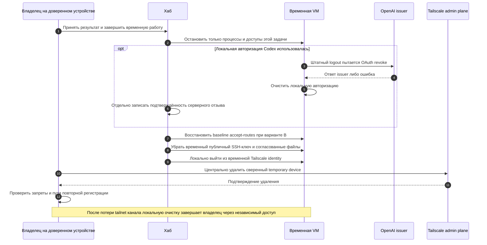

# Временное подключение VM: настроить, отозвать доступ, очистить

## Цель и границы

Сценарий: быстро дать хабу доступ к VM для конкретной настройки, проверить результат и завершить временный допуск. Постоянная регистрация узла, телеметрия, OpsAgent и постоянная личная авторизация Codex для этого не обязательны.

Этот документ — порядок действий оператора. В текущем bootstrap **нет команды `offboard`, режима автоматического истечения допуска или гарантированного удаления всех следов**. Он умеет установить компоненты и восстановить свой baseline `accept-routes` через `rollback`. Отзыв устройств, OAuth и очистка выполняются отдельно. Новые флаги или автоматизация не считаются реализованными из факта появления этого документа.

Завершение допуска означает проверенное прекращение сетевого и сервисного доступа и удаление временных секретов из контролируемой среды. Это не доказательство отсутствия журналов, снимков диска, резервных копий или копий, сделанных другим root. Для VM с недоверенным администратором нельзя гарантировать удаление всех её данных или ранее экспортированных credentials.

Общая схема — в [HLD](HLD.md), ограничения отзыва — в [SECURITY](SECURITY.md).

## Два способа выполнить работу

| Вариант | Где работает Codex | Что попадает на временную VM | Когда выбирать |
| --- | --- | --- | --- |
| **A. Настройка с хаба — предпочтительно для сервисного визита** | На доверенном хабе; команды выполняются через обычный OpenSSH поверх Tailscale | Временная сетевая идентичность и отдельный публичный SSH-ключ хаба | Нужно установить/настроить приложение и передать VM владельцу |
| **B. Локальный Codex через egress** | На временной VM, с HTTPS через App Connector | Дополнительно локальная авторизация Codex и его рабочие данные | Нужен именно нативный CLI внутри этой VM, а не удалённая настройка |

В варианте A личные OAuth-данные Codex остаются на хабе. Не передавайте private SSH key хаба и не включайте agent forwarding. Удалённый root видит и контролирует команды, файлы и результаты своей VM; SSH не делает их доверенными. Считать их недоверенным вводом, включая инструкции для агента внутри файлов и вывода команд. Не выполнять такие инструкции автоматически на хабе, не запускать полученные от VM скрипты без проверки и не раскрывать секреты через параметры команд/вывод. Права агента на хабе ограничить необходимыми для задачи.

Вариант A не требует App Connector routes и `accept-routes` на временной VM: для адресов самих peer-узлов достаточно обычного Tailscale-доступа, разрешённого политикой. Нынешний мастер предназначен для варианта B и устанавливает Codex; отдельного облегчённого режима A в нём пока нет. Tailscale/OpenSSH для варианта A настраивают по штатным инструкциям без запуска ненужной установки Codex.

В варианте B другой полный root может пользоваться и копировать локальную авторизацию. Настройки `0600`, keyring, отдельный Unix-user и контейнер на той же VM не защищают работающий клиент от её полного администратора. Если это неприемлемо, выбирают вариант A либо отдельный доверенный compute и собственный аккаунт каждого пользователя.

## До подключения: ограничить допуск по задаче

1. **Определить границу изменений.** Зафиксировать владельца, назначение VM, ID задания, срок допуска, проверенные hostname/host key и независимый доступ через провайдера. Отметить, какие Tailscale/Codex/SSH-настройки уже существовали. Их нельзя выдавать за созданные этой задачей и удалять при завершении.
2. **Выбрать зону доверия.** Для VM с другим root предпочтителен отдельный сервисный/egress-tailnet. Альтернатива — отдельная identity/tag и заранее проверенные минимальные grants в общем tailnet. Узкий grant рядом с общим `* → *` не изолирует VM. Перенастройка рабочего tailnet требует отдельного плана сохранения остальных доступов.
3. **Подготовить только нужную связность.** Для A — хаб → временная VM TCP/22, ответы на эти соединения и необходимые инфраструктурные сервисы. Для B — дополнительно логический discovery App Connector и утверждённые destination IPv4/443 через согласованный connector. Разрешения к остальным peer/subnet/admin-ресурсам должны быть закрыты и проверены. Учитывают IPv6 и публичные интерфейсы: отсутствие tailnet-доступа не закрывает публичный интернет.
4. **Назначить срок и ответственного.** Указать время административного удаления устройства. Браузерный вход, обычный срок node key, одноразовый auth key и `NETWORK_VERIFIED` не являются автоматическим таймером окончания этой задачи. Если используется ephemeral device, проверить его фактическую регистрацию и условия удаления; не заменять этим явное завершение допуска.
5. **Не выдавать центральные секреты.** Tailscale API/OAuth client secrets, private SSH key хаба и его Codex auth cache на VM не нужны. Центральные approvals и права администратора остаются у владельца.

**Приёмка до работы:** известны точная VM, владелец, срок и список созданных доступов; политика проверена целиком; управление другими узлами сохранено; независимый вход владельца работает. Если подтверждена лишь маршрутизация, изоляция считается непроверенной.

## Подключение и выполнение

### Вариант A: Codex на хабе, OpenSSH к VM

1. Подключить новую временную VM к согласованному tailnet. Проверить фактический ID устройства и Tailscale IP с обеих сторон. Публичный код можно передать с хаба; GitHub-токен VM не требуется.
2. Проверить SSH host fingerprint через доверенный канал. На VM установить **отдельный публичный** ключ с комментарием вида `temporary-maintenance-TICKET-ID`. Ограничить его источником — проверенным Tailscale IP хаба — и `restrict`. Обычные ключи владельца сохраняются. Такой ключ подходит для удалённых команд без PTY/forwarding; необходимость иных функций согласуют отдельно.
3. Хаб выполняет ключом самостоятельный OpenSSH-вход без проброса агента и сверяет identity целевой VM. Проверить необходимые административные права. Наличие IP в `tailscale status` не доказывает успешный SSH-вход.
4. Codex на хабе выполняет согласованную настройку через SSH. Не копирует собственную авторизацию на VM. Рабочие файлы и результаты размещает в заранее выбранных каталогах, временные материалы перечисляет отдельно.
5. Проверить приложение и получить подтверждение результата. Для будущего сопровождения новый допуск можно открыть независимо, с новым ID задания и временным ключом.

### Вариант B: локальный Codex через Connector

1. Пройти [инструкцию оператора](../for-humans/README.md), сохранив исходный сетевой baseline. Войти собственным аккаунтом через штатный device auth, не переносить токены с хаба.
2. Получить свежий `NETWORK_VERIFIED`, проверить реальный запрос и наблюдаемые endpoint-ы. Для этого сценария нужны отдельные approvals; сетевой успех не подтверждает безопасность общего root.
3. Выполнить работу. Не использовать эту VM как долговременное хранилище личных секретов. Сохранить результаты и учесть локальную историю/рабочие данные Codex отдельно от авторизации.

## Плановое завершение допуска



Это плановый порядок для контролируемой VM. При активном инциденте сетевая изоляция имеет приоритет: устройство удаляют центрально немедленно, а неподтверждённый OAuth revoke ведут как отдельную задачу. Не сохраняют опасную связность только ради попытки logout.

### 1. Завершить работу и авторизацию Codex

В варианте A на временной VM нет авторизации Codex, переданной этой задачей. Нельзя выходить из уже существовавшего чужого аккаунта или удалять его данные под видом очистки временного допуска.

В варианте B завершить относящиеся к задаче процессы Codex и выполнить logout под тем же пользователем и с тем же credential store. По умолчанию bootstrap использует root. Из проверенного shell VM:

```bash
sudo -H sh -c '
if [ -x /root/.local/bin/codex ]; then
    exec /root/.local/bin/codex logout
else
    exec codex logout
fi
'
```

Не удалять auth cache до logout: он нужен для попытки серверного отзыва. Проверить отсутствие продолжающих работу клиентов и локальный статус входа. В Codex 0.171/0.172 logout пытается отозвать refresh token через OpenAI, но при ошибке удаляет локальные данные и может завершиться успешно. **Локальный выход и серверный отзыв отмечаются отдельно.** Другой недоверенный root может подменить бинарник/вывод, сохранить копию или продолжать работу из памяти; одной команды на такой VM недостаточно для доказательства отзыва.

Сроки access/refresh, ранее скопированные токены и ограничения принудительного отзыва описаны в [SECURITY](SECURITY.md). Истечение текущего access token не ограничивает общее время использования при действующем refresh token. Завершение Tailscale тоже не отзывает авторизацию OpenAI.

### 2. Восстановить сетевой baseline

Для варианта B, из каталога исходников на VM:

```bash
sudo env PYTHONPATH="$PWD/src" python3 -m tailnet_bootstrap.cli rollback
```

Это восстанавливает только сохранённое `accept-routes` при совпадении identity и профиля. Если исходное значение было `true`, оно останется `true`. `rollback` не выводит устройство из сети и не отзывает Codex. В варианте A, если bootstrap не менял приём маршрутов, этот шаг не нужен.

### 3. Удалить временный SSH-доступ и сетевую identity

- Пока сохраняется рабочий канал управления, удалить **точно сверенную** строку временного публичного ключа из `authorized_keys`. Сохранить ключи владельца, права и владельца файла. Общие SSH-настройки и host keys не менять. Удаление ключа запрещает новые аутентификации, но не завершает уже открытые SSH-сеансы, каналы и ControlMaster. После последних команд очистки отдельно закрыть сеансы этой задачи; контроль выполнить через независимый доступ владельца.
- Если Tailscale identity создана исключительно для этой задачи, выполнить локальный `sudo tailscale logout`. Это разрывает tailnet-канал; должны оставаться консоль провайдера или независимый SSH. Если на VM была прежняя регистрация, её автоматическое удаление недопустимо — нужен иной согласованный план.
- С доверенного устройства администратора удалить **именно временную VM** из Machines/Devices. Хаб и Connector — отдельные устройства; их не удалять вместо клиента. Проверить ID, владельца и адреса перед действием. Центральное удаление служит административным отзывом, который нельзя заменить остановкой daemon на VM.
- Отозвать выданные этой задаче средства регистрации, если они использовались; проверить device approval и возможные повторные регистрации. Отзыв auth key не удаляет созданное им устройство. Возможность человека снова войти в tailnet требует отдельного контроля.
- Удалить относящиеся только к этой задаче policy grants/approvals после проверки зависимостей. Не удалять общие app routes или mapping, которыми пользуются другие клиенты. Удаление маршрута может вернуть прямой интернет и не блокирует OpenAI OAuth.

### 4. Очистить локальные материалы по инвентарю

Оставшиеся действия выполняют через независимый доступ владельца, если временный канал уже закрыт. Перечень ниже — места проверки, а не разрешение безусловно удалить каталоги:

| Материал | Порядок очистки |
| --- | --- |
| Временный публичный SSH-ключ | Удалить только строку задания; проверить сохранность ключей владельца |
| Auth cache / credential store Codex | Штатный logout; учесть все относящиеся к задаче stores и процессы, не печатая их содержимое |
| Новые локальные история и данные Codex | Сначала передать владельцу нужные результаты; удалять только согласованные данные этой задачи |
| `/var/lib/tailscale-codex-bootstrap` или выбранный `--state-dir` | После rollback и фиксации несекретного результата удалить только state этой установки |
| Новое Tailscale state | После logout, центрального удаления и остановки нужного daemon очистить только state новой временной identity; не копировать его в отчёт |
| Специальный systemd drop-in | Удалить только созданный задачей override, затем перечитать systemd; не затрагивать чужую конфигурацию |
| Пакеты Tailscale/Codex и клонированный bootstrap | Удалять, только если установлены для этой задачи и больше никому не нужны; пакетный uninstall не доказывает очистку секретного state |
| Собственные временные архивы/рабочие файлы/tmux | Сверить список, сохранить результат и завершить только процессы/сессии задачи |

Системные журналы, Git-история, provider snapshots и резервные копии имеют собственный жизненный цикл. Очистка текущих файлов не удаляет их копии. Простое удаление или `shred` отдельного файла не доказывает стирание данных на SSD, copy-on-write storage и в облачных снимках. Если требуется вернуть среду в исходное доверенное состояние, результат работы экспортируют без секретов, а временную VM и её диски/снимки уничтожают по процедуре провайдера. Это тоже не отзывает ранее экспортированные bearer tokens: их отзывает issuer.

## Критерии завершения

| Проверка | Что требуется зафиксировать |
| --- | --- |
| Результат настройки | Приложение/сервис принят, необходимые рабочие данные у владельца |
| Временный SSH | Строка ключа удалена, повторный вход этим ключом запрещён, существующие сеансы/каналы задачи закрыты, вход владельца сохранён |
| Tailscale | Правильный device удалён центрально, локальная identity закрыта, доступ к прежним peer-ресурсам прекратился |
| Повторная регистрация | Проверены auth keys, административные права и device approval; нет новых неожиданных устройств |
| Codex | В A личная авторизация не передавалась; в B локальный logout подтверждён, серверный revoke подтверждён отдельно либо записан незавершённым |
| Локальная очистка | Материалы инвентаря удалены в согласованной области; чужие данные и ключи сохранены |
| Остальная инфраструктура | Хаб, Connector и другие узлы сохранили рабочие доступы |
| Остаточные ограничения | Копии, снимки, журналы и неотозванные/непроверенные grants перечислены, а не объявлены исчезнувшими |

Неуспешный ping не заменяет проверку отзыва устройства; отсутствие локального auth cache не доказывает отзыв копии токена; удалённый App Connector route не доказывает отсутствие прямого Интернета.

Если серверный отзыв использованной авторизации Codex не подтверждён, весь offboarding отмечают **частично завершённым**, даже при успешной очистке VM и удалении Tailscale device. Неподтверждённый доступ остаётся открытой задачей владельца.

## Источники

- [Удаление устройства Tailscale](https://tailscale.com/docs/features/access-control/device-management/how-to/remove).
- [Auth keys и отдельный жизненный цикл устройств](https://tailscale.com/docs/features/access-control/auth-keys).
- [Ephemeral nodes](https://tailscale.com/docs/features/ephemeral-nodes): применение требует отдельной настройки, которую текущий wizard не выполняет.
- [Codex authentication](https://learn.chatgpt.com/docs/auth).
- [Проверенный OAuth revoke Codex 0.172.0](https://github.com/openai/codex/blob/rust-v0.172.0/codex-rs/login/src/auth/revoke.rs).
- [Ограничения Active sessions](https://help.openai.com/en/articles/20001257-managing-active-sessions-in-chatgpt).
